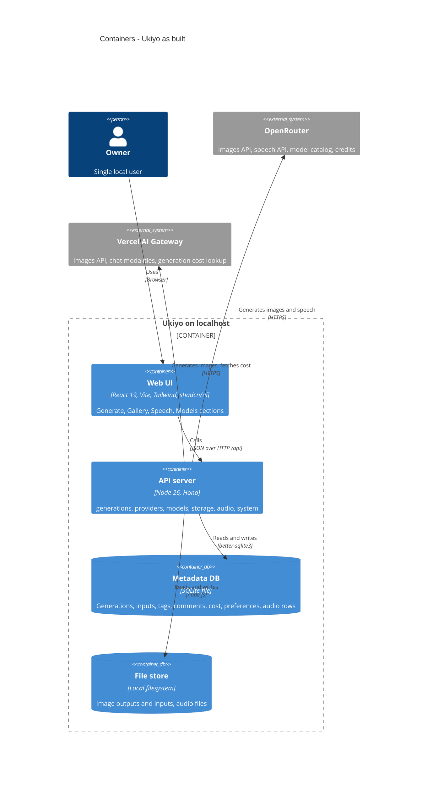

# Architecture map — Ukiyo

> **Current map** (brownfield scan of `cbb9c47`, branch `feature/audio-generation`). It replaces the
> greenfield foundation map of `96e6530`: the skeleton and roadmap steps 2–14 are built and merged
> into `main`; on `feature/audio-generation`, roadmap step 18 rebuilt the text-to-speech prototype
> (`a1169a1`, `cbb9c47`) on the conventions below (ADR-0039…0046 in `docs/features/text-to-speech/adr/`).
> Foundational decisions: [ADR-0001](./adr/0001-use-typescript-node-hono-react-stack.md),
> [ADR-0002](./adr/0002-organize-as-modular-monolith-with-provider-port.md),
> [ADR-0003](./adr/0003-store-metadata-in-sqlite-and-images-on-disk.md); feature ADRs 0004–0038 live in
> `docs/features/<slug>/adr/`.

**What it is:** a local-first web app for one user on one machine. A Node server bound to
`127.0.0.1` calls OpenRouter and Vercel AI Gateway to generate images (text→img, img→img,
img+text→img), stores every generation locally (image files + inputs + full metadata) and serves a
React gallery to inspect, comment, tag, delete, re-run and reuse outputs, filtered or grouped by
model and by identical prompt. An Audio section turns text into speech with any OpenRouter speech model.
No auth, no sync, no multi-user.

## Stack

- Language / runtime: TypeScript ^5.9 (strict), ESM, Node ≥ 26 (`.nvmrc`, `package.json#engines`)
- Package manager: pnpm (single package)
- Server: Hono ^4.13 + `@hono/node-server` ^2.1, bound to `127.0.0.1:8787` (`src/server/lib/config.ts:6`)
- Frontend: React ^19.3 + Vite ^8.3, Tailwind CSS ^4.3 (`@tailwindcss/vite`), shadcn/ui (radix-ui ^1.8),
  lucide-react, TanStack Query ^5.104
- Validation / shared types: zod ^4.6 schemas in `src/shared/`
- Persistence: SQLite via better-sqlite3 ^13 (hand-written SQL, WAL) + files under the data dir
- IDs: `ulid` ^3 (monotonic)
- Provider HTTP: plain `fetch`, no vendor SDK
- Build / test / lint: `pnpm build` (`tsc --noEmit` + `vite build`) · `pnpm test` (Vitest ^5: projects
  `unit`, `integration`, `web`, `nfr`, `nfr-web`) · `pnpm typecheck` · `pnpm lint` (Biome ^2.5)
- CI: none — the local gate is `pnpm typecheck && pnpm lint && pnpm test`.

## C4 — system as it is

## Module inventory

| Module | Path | Layers | Wired at | Responsibility | Status |
|---|---|---|---|---|---|
| system | `src/server/modules/system/` | routes | `src/server/app.ts:49` | `GET /api/health` | built |
| providers | `src/server/modules/providers/` | ports (`port.ts` image, `speech-port.ts` speech — ADR-0039) + registries + adapters (`openrouter.ts`, `vercel.ts`, `openrouter-speech.ts`) + `catalog.ts`, `speech-catalog.ts` + `prices.ts` + routes | `src/server/app.ts:52-58` | `ImageProvider` port (generate, optional `lookupCost`, optional `priceOf`); OpenRouter `/api/v1/images`; Vercel images + chat modalities + `GET /v1/generation?id=` cost lookup; cached model catalog; published prices | built (steps 2–4, 7) |
| generations | `src/server/modules/generations/` | domain / service / repo / routes + `jobs.ts` (single-slot job) + `cost-sync.ts` + `promptKey.ts` | `src/server/app.ts:62-78` | start (async job, polled), list (cursor, by model, by prompt), prompt groups, get, re-run/reuse lineage, comment, tag, delete; background cost resolver (`pending → known/unavailable`) | built (steps 2–6, 11–14) |
| models | `src/server/modules/models/` | repo / routes | `src/server/app.ts:60` | per-model preferences (favorite, hidden) per provider + model id | built (steps 9–10) |
| storage | `src/server/modules/storage/` | infra (`file-store.ts`) | injected into the generations and audio services | staged image dirs `.staging/<id>/` → `generations/<id>/` and audio files `.staging/audio-<id>.<ext>` → `audio/<id>.<ext>` by one synchronous rename inside the DB transaction; trash/restore/purge on delete; one boot sweep for both (ADR-0042) | built |
| audio | `src/server/modules/audio/` | routes / service / domain / repo + `wav.ts` | `src/server/app.ts` (`createApp`) | text-to-speech recordings: validate against the speech model, speak through the speech port, wrap raw PCM as WAV, save file + row atomically (file store), cost `pending → known/unavailable` via a second cost-sync instance, list (cursor, one model), model groups, tags + one comment (own tables), delete atomically (cascade), serve files; display names stored → last catalog read (`peek`) → id, never waiting on the provider (ADR-0052) | built (steps 18–19) |
| db | `src/server/db/` | infra (`client.ts`, `migrate.ts`) | `src/server/index.ts:10` | open SQLite (WAL); apply pending migrations on every boot | built |
| lib | `src/server/lib/` | shared (`errors.ts`, `ids.ts`, `config.ts`, `request-guard.ts`) | imported | `AppError` + envelope, ULIDs, env via zod, Host/Origin/fetch-metadata guard (ADR-0007) | built |
| shared | `src/shared/` | contracts | server + web | zod DTOs: `generations`, `providers`, `models`, `pricing`, `curation`, `rerun`, `model-groups`, `errors`, `health`, `image-sniff`, `speech` (recordings) + `speech-models` (family spec map, ADR-0040) | built |
| web | `src/web/` | `features/{generate,gallery,media-gallery,models,audio}`, `components/ui`, `lib/{api,router,format,query-client,playback}`, `sections.tsx` | `src/web/main.tsx` | SPA; navigation in section groups Image / Audio (ADR-0046); `media-gallery` = the dialog engine, notes card and grid primitives shared by both galleries (ADR-0049); one recording plays at a time (ADR-0050) | built |

## Conventions (cited — the rules a new feature must match)

- **Module wiring / registration:** `createApp(deps)` (`src/server/app.ts:47`) builds every module by
  hand from explicit deps (`config`, `db`, optional `fetch`, `now`, `timers`, timeouts — `app.ts:25-38`)
  and mounts each `register<Module>Routes(api, deps)` under `/api` (`app.ts:90`). Boot side effects
  run inside `createApp`: prompt-key backfill, file sweep, cost resume (`app.ts:75-77`).
  `stopBackground()` cancels timers on shutdown (`src/server/index.ts:19-26`).
- **Error handling:** `AppError(code, message, status, details?)` with a closed code union
  (`src/server/lib/errors.ts:4-24`); one `onError` renders `{ error: { code, message, details? } }`.
  Adapters throw `ProviderError(provider, upstreamStatus, message)` (`providers/port.ts:34`), mapped
  to `PROVIDER_ERROR` with `details.provider` + `details.upstreamStatus`.
- **IDs:** `newId(now)` monotonic ULID (`src/server/lib/ids.ts:6`); newest first = `ORDER BY id DESC`;
  paging is a cursor by id.
- **Persistence / DB access:** prepared statements in a per-module `repo.ts`; every row zod-parsed
  (snake → camel) before leaving the repo — e.g. `src/server/modules/audio/repo.ts:5-31`.
  Money: integer `cost_micros` + `cost_status` (`known | pending | unavailable`) with a CHECK tying
  them (`migrations/0002_create_generations.up.sql:16`); deferred price via `cost_ref`
  (`migrations/0005_add_generation_cost_ref.up.sql`). Timestamps ISO-8601 UTC text.
- **Deferred cost:** `createCostSync({ repo, lookupFor })` (`src/server/modules/generations/cost-sync.ts`) — one instance per record kind (images, recordings — ADR-0043); bounded
  backoff lookups (5 s doubling to 60 s, 8 attempts, 10-min deadline) through the adapter's optional
  `lookupCost(costRef)` (`providers/port.ts:45,53`); resumes pending rows on boot; `forget(id)` on
  delete (ADR-0013). Implementation: Vercel `lookupCost` (`providers/vercel.ts:149`).
- **Files:** never in the DB — only relative paths; written through `storage/file-store.ts`
  (stage → `commitSync` inside the DB transaction → boot sweep; ADR-0006, ADR-0014), paths resolved
  with traversal guard (`file-store.ts` `resolveRecorded`).
- **Migrations:** paired `migrations/NNNN_snake_name.up.sql` / `.down.sql`; runner
  `src/server/db/migrate.ts:13-50` records `schema_migrations`; applied on boot. A shipped migration
  is never edited — a change is a new pair.
- **Config & secrets:** `.env.local` → zod (`src/server/lib/config.ts`): `OPENROUTER_API_KEY`,
  `AI_GATEWAY_API_KEY`, `GEN_IMG_DATA_DIR` (default `./data`, `config.ts:14`), `PORT`. Keys never reach
  the browser.
- **Tests:** Vitest projects (`vitest.config.ts`): `unit` `*.test.ts`, `integration` `*.int.test.ts`
  (real SQLite in a temp dir via `tests/helpers/test-app.ts` `createTestApp` + `app.request()`),
  `web` `*.test.tsx` (jsdom, `tests/helpers/setup-dom.ts`), `nfr` / `nfr-web` (serial, last).
  Provider HTTP stubbed by `tests/helpers/fake-fetch.ts` from `tests/fixtures/{openrouter,vercel}/`
  (incl. `openrouter/speech-models.json`).
- **Lint / typecheck:** Biome (`biome.json`); `tsc --noEmit` strict.
- **Inter-module communication:** in-process calls through injected services; generations reach
  providers only through the registry (`providers/registry.ts:17`), never branching on provider.
- **HTTP API shape:** JSON under `/api/*`, resource-oriented; bodies are zod schemas in `src/shared/`
  used by both the route and `src/web/lib/api.ts`. Image bytes from `/api/files/<relative path>`.
- **UI / styling:** Tailwind v4 utilities + shadcn/ui primitives (`src/web/components/ui/`); no second
  component library, no CSS-in-JS.

## Datastores

| Store | Engine | Accessed via | Notes |
|---|---|---|---|
| Metadata DB | SQLite (`<data dir>/gen-img.db`, WAL) | `*/repo.ts` (better-sqlite3) | migrations 0001–0014 (0013 `audio_generation_tags` / `audio_generation_comments`, cascading; 0014 `audio_generations_by_model`): `generations` (+ cost_ref, source lineage, prompt_key), `generation_images`, `generation_inputs`, `generation_comments`, `generation_tags`, `model_preferences`, `audio_generations` (rebuilt by 0012: provider, model_name, nullable voice, `cost_status`, `estimate_micros`, `duration_ms`) |
| File store | local fs under `<data dir>` | `storage/file-store.ts` (images and audio) | `generations/<id>/output-N.<ext>`, `input-N.<ext>`; `audio/<id>.mp3\|wav`; `.staging/` for atomic commit/delete |

## Frontend / UI foundation

- **Component library:** shadcn/ui in `src/web/components/ui/` — badge, breadcrumb, button, card,
  dialog, dropdown-menu, input, label, popover, select, separator, sheet, sidebar, skeleton, slider,
  switch, table, tabs, textarea, tooltip. App components: `components/app-sidebar.tsx`,
  `NotFound.tsx`, `mode-toggle.tsx`, `theme-provider.tsx`. Canon + inventory: `docs/design-system.md`.
- **Design tokens:** shadcn CSS variables light/dark in `src/web/index.css:5`, `@theme inline` at `:67`.
- **Styling:** Tailwind v4 utilities only.
- **State / data-fetching:** TanStack Query (`src/web/lib/query-client.ts`); typed client
  `src/web/lib/api.ts` (`request(schema, path)` parses every answer with the shared zod schema;
  `ApiError` carries the envelope code).
- **Routing / app frame:** History API router `src/web/lib/router.tsx` (detail routes
  `/generations/:id` and `/audio/recordings/:id`, each rendered by its owning section's `detail` — ADR-0048; everything else a page); one section registry `src/web/sections.tsx` drives the
  sidebar (`app-sidebar.tsx`: one «Sections» nav with a labelled group per section group — Image, Audio;
  ADR-0046), page, breadcrumb, title and not-found (ADR-0022); Generate stays mounted, Speech mounts on
  its first visit and then stays (ADR-0023, ADR-0045). Current sections: Image — Generate `/`, Gallery
  `/gallery`, Models `/models`; Audio — Speech `/audio/speech` (former `/speech` redirects), Gallery `/audio/gallery` (accessible name «Audio gallery»).
- **Theme:** light/dark/system (ADR-0024).
- **Closest UI precedents:** gallery grid + detail modal (`features/gallery/Gallery.tsx`,
  `GenerationDialog.tsx`, `Tile.tsx`, `CardBadges.tsx`, `Notes.tsx`, `DeleteGeneration.tsx`); Models
  table (`features/models/ModelsPage.tsx`); generate panel (`features/generate/GeneratePanel.tsx`).

## Where things live / closest precedents

- New server capability → `src/server/modules/<module>/` (`routes.ts` + `service.ts`, `repo.ts`,
  `domain.ts`), wired in `createApp`. Precedent: `generations`.
- New provider / call path → an adapter in `src/server/modules/providers/` behind a port; precedent
  `ImageProvider` (`port.ts:47`) + `registry.ts`.
- Deferred cost → reuse `createCostSync` + an adapter `lookupCost`.
- New table/column → new `migrations/NNNN_*` pair via `/sdd:data-model`.
- New HTTP contract → zod in `src/shared/`, used by route and `src/web/lib/api.ts`.
- New section → one `SECTIONS` entry + page under `src/web/features/<feature>/`.

## Constraints & known tech-debt

- **Local-only, single user:** `127.0.0.1` only; no auth; request guard (ADR-0007).
- **Provider drift:** model ids, prices and parameters change fast; catalogs are fetched live and cached.
- **Vercel cost is asynchronous** → `pending` is a first-class cost state.
- **Audio (step 18):** the prototype (`a1169a1`, `cbb9c47`) was rebuilt on the conventions above; its 19
  recordings were kept by migration 0012 (amounts → `known`). Speech model knowledge lives in a hand-kept
  family spec map (`src/shared/speech-models.ts`) because OpenRouter publishes no speech parameters.
- **Native module:** better-sqlite3 prebuilt for Node 26.
- **No CI.**

## Reconciliation with the authored architecture doc

No authored architecture doc besides root `CLAUDE.md`, which this map agrees with (stack, layout,
conventions, hard rules). The previous greenfield map's *(target)* paths all exist now.
