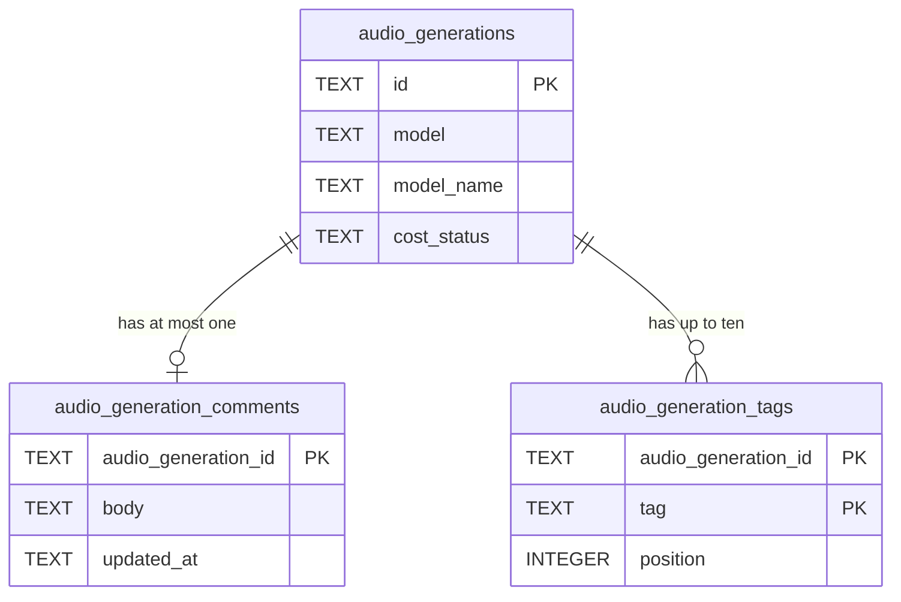

# Data model — audio-gallery

> Sources: spec §5 (AC-07, AC-08, AC-10, AC-11, AC-13, AC-14, AC-21) + §6, sad.md §5/§6 (flows 3, 4, 5) + §8, ADR-0047, ADR-0051, ADR-0052.
> Conventions followed (from `migrations/0006`, `0009`, `0012` and `architecture-map.md` §Conventions): snake_case, TEXT ULID keys,
> `CHECK` constraints, ISO-8601 UTC text, hard delete with `ON DELETE CASCADE` children, `IF NOT EXISTS` DDL, paired up/down files.

## Aggregates

| Aggregate root | Owns | Module |
|---|---|---|
| Recording (`audio_generations`, unchanged) | its audio file, settings, cost; **new:** its comment (`audio_generation_comments`) and tags (`audio_generation_tags`) | `src/server/modules/audio/` |

Image curation (`generation_comments`, `generation_tags`) is untouched and never joined with these (spec AC-10).

## ER

(`audio_generations` shows only the columns this step reads; full shape in [text-to-speech data-model](../text-to-speech/data-model.md).)

## Entities

### audio_generation_comments (new)

| Column | Type | Null | Constraint / meaning |
|---|---|---|---|
| audio_generation_id | TEXT | no | PK; references `audio_generations(id)` ON DELETE CASCADE — one comment per recording |
| body | TEXT | no | `length(trim(body)) > 0 AND length(body) <= 2000` (characters); an empty comment is a deleted row |
| updated_at | TEXT | no | ISO-8601 UTC of the last save |

### audio_generation_tags (new)

| Column | Type | Null | Constraint / meaning |
|---|---|---|---|
| audio_generation_id | TEXT | no | references `audio_generations(id)` ON DELETE CASCADE |
| tag | TEXT | no | `length(tag) BETWEEN 1 AND 32 AND tag = lower(trim(tag))`; normalized by `src/shared/curation.ts` before insert |
| position | INTEGER | no | `>= 1`, insertion order (`max(position)+1` per recording) |
| | | | PK `(audio_generation_id, tag)` — each tag once per recording |

The ≤ 10 tags rule is enforced in the repo's add-tag transaction (as for images, ADR-0015), not by the schema.

### audio_generations (unchanged)

No column is added, changed or rewritten; no row is changed (ADR-0052 chose read-time name resolution over a backfill).

## Indexes

| Index | Columns | Query it serves |
|---|---|---|
| PK `audio_generation_comments` | audio_generation_id | comment of one recording (detail) and of a page (`IN (…)`); FK lookup on cascade |
| PK `audio_generation_tags` | audio_generation_id, tag | tags of one recording / a page in position order; duplicate check; count for the ≤ 10 rule; FK lookup on cascade |
| `audio_generations_by_model` (new) | model, id | one model's page newest first (`WHERE model = ? AND id < ? ORDER BY id DESC`), model groups (`GROUP BY model` → count, `max(id)`), four latest per model, newest stored name per model (sad §6 flow 5) |
| PK `audio_generations` (existing) | id | the «All» page newest first, get by id |

## Migrations (staged)

| Ordinal | Files | What |
|---|---|---|
| 01 | `migrations/01_create_audio_curation.{up,down}.sql` | create both child tables; `down` drops them |
| 02 | `migrations/02_index_audio_generations_by_model.{up,down}.sql` | add `(model, id)` index on the existing table; `down` drops it |

Additive only — no breaking change, no expand/contract needed. Promoted by `implement` as `0013_create_audio_curation` and `0014_index_audio_generations_by_model` (next free numbers after 0012).

## Test fixtures

- `tests/helpers/recordings.ts` `seedRecording(db, dataDir, overrides)` (step 18) gains optional `tags` / `comment` overrides that insert child rows.
- Migration test: a DB migrated to 0012 with prototype-shaped rows → apply 0013 + 0014 → every `audio_generations` row byte-identical, cascade removes children on delete; roll back both → tables and index gone, rows intact.

## Drift

Domain layer `src/server/modules/audio/repo.ts` `Row` maps `audio_generations` 1:1 (no drift). The new tables have no domain code yet; implement adds `TagRow` / `CommentRow` parsers mirroring `generations/repo.ts`.
