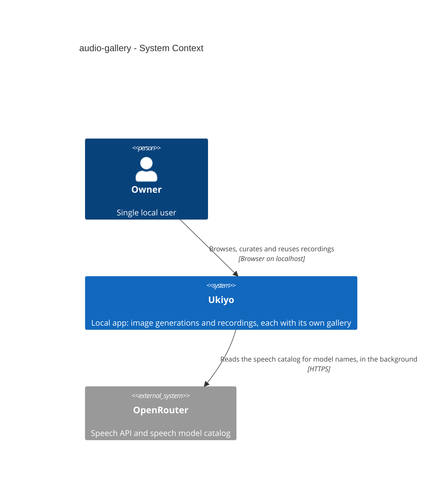
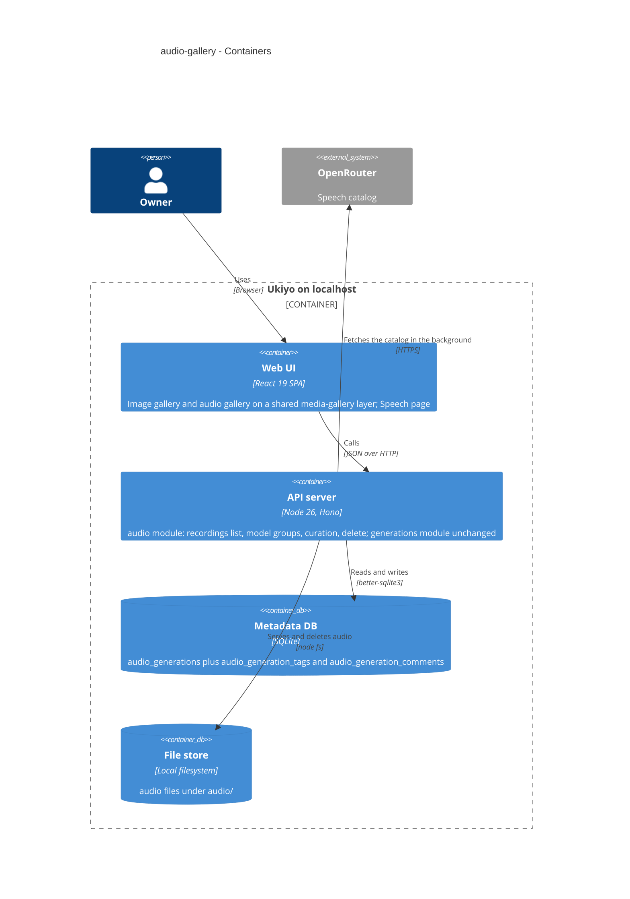
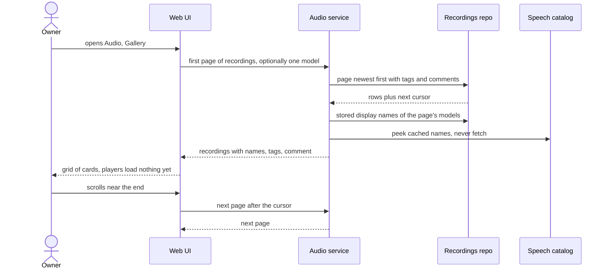

# Software Architecture Document — audio-gallery

## 1. Introduction and goals

**Intent.** Give the Owner's recordings the browsing and curation that image generations already have (spec §2): an Audio → Gallery section with a paged grid of recording cards, a dialog with stepping and its own address, tags and one comment per recording, delete, a one-model filter and a «By model» overview, and Reuse into the Speech page. It is built from the image gallery's pieces, which are made media-agnostic where they are truly common, without changing any image behaviour (spec AC-20).

**Top-3 quality goals (1-liners; full scenarios in §10):**

1. **No regression in the image gallery** while its building blocks become shared (spec AC-20, §6 «Image gallery unchanged»).
2. **One coherent library across Speech and Gallery** — a change in one place (new, curated, deleted, cost settled) shows everywhere without reloads and without paging storms (spec AC-04, AC-11, AC-18, §6 request rows).
3. **Gallery reads stay fast and catalog-independent** — ≤ 300 ms p95 pages with 1 000 recordings, with the speech catalog unreachable (spec §6).

**Stakeholders.**

| Role | Interest | Sign-off owner? |
|---|---|---|
| Owner | browses, curates, deletes and reuses recordings | Yes (product) |
| Tech Lead | SAD approval, shared-component boundaries | Yes |

**Decision overrides (¶4).** None.

## 2. Constraints

**Technical.**

- TypeScript 5 strict on Node 26; Hono server on `127.0.0.1`; React 19 + Vite SPA; TanStack Query; Tailwind v4 + shadcn/ui; SQLite via better-sqlite3 with hand-written SQL, foreign keys ON (`src/server/db/client.ts`).
- Modular monolith: the `audio` module owns recordings (`src/server/modules/audio/`), the `generations` module owns images; they never read each other's tables (roadmap decision «image and audio stay separate modules and tables»).
- History-API router with one detail kind today (`/generations/:id`, `src/web/lib/router.tsx`); the section registry `src/web/sections.tsx` drives the navigation (ADR-0022, ADR-0046).

**Organisational.**

- One owner, one machine; all audio steps (18–21) land on `feature/audio-generation` as one PR (roadmap). No paid provider calls are needed for this step.

**Conventions.**

- [`CLAUDE.md`](../../../CLAUDE.md) + [`architecture-map.md`](../../architecture-map.md): explicit deps into `createApp`; `AppError` envelope; ULIDs newest-first by id; per-module `repo.ts` with prepared statements and zod-parsed rows; paired migrations, a shipped migration is never edited.
- Step-18 handoff: never edit migrations 0011/0012 and never rebuild `audio_generations`; child tables cascade from it.

**Regulatory / external.**

- N/A — local single-user tool; deletion is hard delete with no undo (CONTEXT: Deletion).

## 3. Context and scope

The Owner uses the browser on their own machine. Ukiyo's server stores recordings (rows + audio files) and calls OpenRouter only for the speech catalog (model names) and, on the Speech page, for speech. This step adds no new external interaction: the gallery reads, curates and deletes local data only.

<!-- brownfield: architecture-map.md reflects the step-18 state; this step touches audio (server + web), the gallery feature's shared pieces, router, App frame and sections registry. -->

**External systems (in / out):**

| Actor or system | Type | Interaction |
|---|---|---|
| Owner | Person | browses, plays, tags, comments, deletes, reuses recordings |
| OpenRouter | System (external) | speech catalog (display names of models), read in the background and cached; never on a gallery request's critical path (ADR-0052) |

**C4 Context (L1):**



## 4. Solution strategy

**Target surfaces.** `backend-service` (new list filters, model groups, curation endpoints and two tables in the audio module) + `web-frontend` (the Audio → Gallery section). Same two containers as every earlier step; no ADR (no new surface). **UI architecture:** unchanged SPA with client-side routing (ADR-0022); the only routing change is a second detail kind (ADR-0048).

**Top strategic choices (the seeds for ADRs):**

1. **Recording curation lives in the audio module, in its own child tables** — `audio_generation_tags` and `audio_generation_comments` cascade from `audio_generations`, mirroring the image constraints; the shared rules (`src/shared/curation.ts`) validate both (ADR-0047). The audio module gets list-by-model, model groups and curation endpoints, and one recording DTO that carries tags and the comment everywhere (ADR-0051).
2. **Share the image gallery's media-agnostic pieces, keep the media-specific ones apart** — the notes card, the dialog's stepping engine and frame, the busy/escape/delete contexts, neighbours, grid place memory and paging sentinel become a shared `media-gallery` layer the image gallery and the audio gallery both use; cards, details, view parsing and query keys stay per medium (ADR-0049). The router learns a recording detail kind, and sections declare their own detail/dialog renderers (ADR-0048).
3. **Cross-section coherence through the query cache and the address** — recordings live under the `["recordings"]` key family, so a change invalidates or patches every audio view and the Speech page in one place; Reuse hands over through the Speech page's address (ADR-0053); one app-wide playback rule keeps a single recording playing (ADR-0050).
4. **Reads never wait on the provider** — model display names come from stored names, then the last speech catalog Ukiyo read (warmed in the background at boot), then the id; stored rows are never rewritten (ADR-0052).

## 5. Building block view

Layered modules as today (routes → service → repo/domain on the server; feature folders on the web). The new pieces:

**Internal decomposition:**

```
migrations/0013_create_audio_curation.{up,down}.sql   (to be staged by data-model under docs/features/audio-gallery/migrations/)
src/shared/speech.ts            Recording += tags, comment; RecordingModelGroup(s); RecordingPage unchanged shape
src/shared/curation.ts          unchanged rules, reused by both media
src/server/modules/audio/
├── repo.ts                     list({cursor, limit, model?}), modelGroups({latest}), tags/comment statements,
│                               storedNames(models)
├── service.ts                  list/get add tags+comment and names; setComment/addTag/removeTag; models()
├── routes.ts                   ?model= on the list; /audio/recordings/models; comment + tags routes
src/server/modules/providers/speech-catalog.ts   peek(provider) — the last successful entry (even past its TTL) or undefined, never fetches
src/web/lib/router.tsx          route kind «recording» for /audio/recordings/:id; dialogState carries its gallery
src/web/sections.tsx            Section.detail = { route, label, Page, Dialog } next to the existing `owns`; Audio «Gallery» section at /audio/gallery
src/web/App.tsx                 renders the owning section's detail page or dialog instead of hard-wired generation ones
src/web/features/media-gallery/ shared: NotesCard, useDialogStepping + DialogFrame, DialogBusy contexts, neighbours,
                                gridPlace (card attribute param), usePagingSentinel
src/web/lib/playback.ts         app-wide playback coordinator, installed by the App frame (ADR-0050)
src/web/features/gallery/       image gallery, now consuming media-gallery (thin wrappers: Notes, GenerationDialog)
src/web/features/audio/gallery/ AudioGallery (grid + views), RecordingCard, RecordingDialog, RecordingDetail,
                                RecordingNotes, audioGalleryView, queries, patchRecordings, useRecordingPendingCost
src/web/features/audio/SpeechPage.tsx            applies ?reuse=<id> on arrival (ADR-0053)
```

**C4 Container (L2):**



## 6. Runtime view

**Critical flow 1: open the audio gallery and page through it** (spec AC-01, AC-03, AC-13)



Further flows (dialog stepping, curation, deletion, model views, reuse, pending cost, boot backfill) are added to this section by `sequences`.

## 7. Deployment view

Unchanged: one Node process on `127.0.0.1:8787` serving the API and the built SPA; data under `GEN_IMG_DATA_DIR`. Migration 0013 applies on the next boot. No new process, port or configuration.

## 8. Crosscutting concepts

- **Query keys.** Every recordings read sits under `["recordings"]`: `["recordings","recent"]` (Speech recent recordings), `["recordings","list",view…]` (gallery views), `["recordings","models"]` (model choice + By model), `["recording", id]` (detail). A new recording or a deletion invalidates `["recordings"]` (views not on screen re-read only when next shown); a deletion from the dialog first removes the card in place, as for images; a curation or cost change patches the cards in place by data shape (as `patchSummaries` does for images, ADR-0034) and invalidates only the detail and the recent list.
- **Pending cost.** A pending card mounts a watcher that reads only that recording every 10 s and patches it everywhere when it settles (the image precedent, ADR-0031); the Speech recent list keeps its own 10 s refresh (step 18).
- **Playback.** One coordinator (ADR-0050): a capture-phase `play` listener pauses every other media element; every route change pauses everything playing; the Speech page autoplays a fresh result only while it is the shown section.
- **Dialog stepping.** The shared engine (ADR-0049) owns neighbours, next-page loading, busy blocking, Esc claims, delete-then-move and close-to-place; each medium supplies its list query, its detail renderer, its address and its notices («Generation deleted.» vs «Recording deleted.»).
- **Errors.** Server: `NOT_FOUND` for unknown recordings on every curation route; `VALIDATION_ERROR` with `details.fields.tag|body` from the shared rules; deletion keeps step 18's atomic file move. Web: the same plain messages as the image gallery with recording wording.
- **Security.** Every new route sits behind the existing request guard (ADR-0007); tags and comments render as text nodes only.

## 9. Architecture decisions

| ADR | Decision |
|---|---|
| [0047](./adr/0047-store-recording-tags-and-comments-in-their-own-cascading-tables.md) | Store recording tags and comments in their own cascading tables |
| [0048](./adr/0048-add-a-recording-detail-route-and-let-sections-own-their-detail-renderers.md) | Add a recording detail route and let sections own their detail renderers |
| [0049](./adr/0049-extract-a-shared-media-gallery-layer-from-the-image-gallery.md) | Extract a shared media-gallery layer from the image gallery |
| [0050](./adr/0050-coordinate-playback-app-wide-so-one-recording-plays-at-a-time.md) | Coordinate playback app-wide so one recording plays at a time |
| [0051](./adr/0051-carry-tags-and-the-comment-on-the-one-recording-dto-and-add-model-views-to-the-audio-api.md) | Carry tags and the comment on the one recording DTO and add model views to the audio API |
| [0052](./adr/0052-resolve-model-display-names-without-waiting-on-the-speech-catalog.md) | Resolve model display names without waiting on the speech catalog |
| [0053](./adr/0053-hand-reuse-to-the-speech-page-through-its-address.md) | Hand Reuse to the Speech page through its address |

## 10. Quality requirements

| Scenario | When | Then | How verified |
|---|---|---|---|
| A gallery page | any page (first or continued, all or one model) of 24 recordings, from 1 000 recordings across 30 models, each with 10 tags and a comment | ≤ 300 ms p95 server time | `nfr` integration test over a seeded data dir |
| Model choice and «By model» | the model list with counts, and the groups with their four latest cards, with 1 000 recordings across 30 models | ≤ 300 ms p95 server time | `nfr` integration test |
| Tag / comment save | one save | ≤ 100 ms p95 server time | `nfr` integration test |
| Delete | recording + file + tags + comment | ≤ 300 ms p95 server time; after a failed or interrupted deletion the recording is either fully present or fully gone | integration test with a failing file step |
| Requests while browsing | the Owner browses | ≤ 1 request per page; none while one is in flight or after the last; a dialog step costs ≤ 1 recording read and 0 for one already read; a tag or comment change costs 0 list-page reads | component test counting requests |
| Pending cost on cards | a cost settles | a settled cost shows on every visible card, dialog and page within 10 s; refreshed by asking only for the pending recordings, not every loaded page, at most once every 10 s | component test counting requests |
| Audio loading | cards appear | 0 audio bytes fetched for cards the Owner hasn't played | component test (player preload) |
| Image gallery unchanged | after the extraction | every existing image gallery, dialog, curation, model and prompt view test passes with no change to what it expects | the existing `web` and `integration` suites, run before and after the extraction |
| Catalog independence | speech catalog unreachable or hanging | the targets above hold | `nfr` test with a hanging fake catalog |
| Migration safety | 0013 on the Owner's DB | the new storage applies on top of the Owner's current recordings database without changing or losing any recording | migration test on a prototype-shaped copy + ship check on a copy of the Owner's data |

## 11. Risks and technical debt

| Risk / debt | Severity | Mitigation | Owner |
|---|---|---|---|
| Extracting the dialog engine changes image behaviour subtly (focus, scroll, history) | Medium | image test suites unchanged (§10); extraction lands in its own tasks before any audio UI; review compares diffs | Tech Lead |
| Server curation SQL exists twice (generations repo inline, audio repo) | Low | both validated by the one shared rule module; a later refactor can extract a curation store factory once a third medium appears | Tech Lead |
| Before the first catalog read after a start, a model known only from prototype rows shows its id | Low | the catalog is warmed in the background at boot; the last successful read is kept past its TTL | Tech Lead |
| A recording finishing, or a deletion, while the gallery is shown re-reads the loaded pages of the views on screen (one request per loaded page) | Low | same cost as the image gallery's refresh rule (gallery-by-model §6); pages are small; views off screen re-read only when shown | Tech Lead |

## 12. Glossary

See [CONTEXT.md](../../../CONTEXT.md): Audio gallery, Recording, Recent recordings, Reuse (recording), Tag, Comment, Cost status, Deletion, Section, Speech model.
