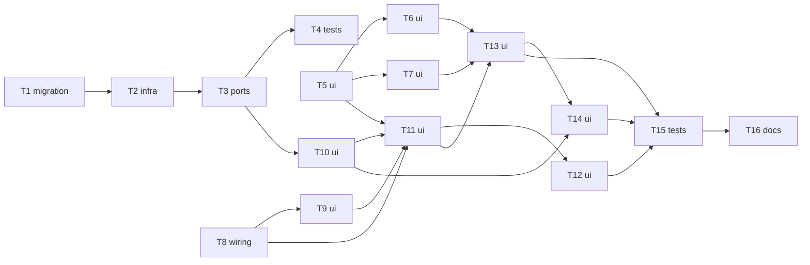

# Epic — audio-gallery

> **Spec:** [spec.md](../spec.md) · **Design:** [sad.md](../sad.md) · **Data model:** [data-model.md](../data-model.md) · **API:** [openapi.yaml](../contracts/openapi.yaml) · **Screens:** [screens.md](../screens.md) · **ADRs:** [adr/](../adr/)

## Goal

Every recording the Owner made becomes findable, playable, curatable and reusable from an Audio → Gallery section that behaves like the image gallery (spec §2), built on a shared media-gallery layer extracted from the image gallery without changing it.

## Scope

- **In:** audio module (repo, service, routes, migrations 0013/0014), shared speech schemas, speech catalog `peek`, router/sections/App detail generalisation, media-gallery layer, audio gallery UI, Speech page reuse handoff, playback coordinator.
- **Out:** By prompt, search, tag autocomplete, presets/Voices (step 21), Models page audio (step 20), folders, mixed gallery, bulk actions (spec §3).

## Task map

Two parallel branches start at once: the server chain T1→T4 and the web extraction T5–T8 (T5, T8 have no deps).

## Tasks

See [tracker.md](./tracker.md) for status. Machine contract: [tasks.json](../tasks.json).

| # | Task | Layer | Blocked by | DoD (short) |
|---|---|---|---|---|
| [T1](./T1-promote-audio-curation-migrations.md) | Promote the audio curation migrations and test them on prototype-shaped data | migration | — | migration test passes: apply, cascade, rollback |
| [T2](./T2-audio-repo-curation-and-model-queries.md) | Add model filter, model groups, stored names and tag/comment statements to the recordings repo | infra | T1 | repo integration tests for every new method pass |
| [T3](./T3-audio-service-routes-and-shared-schemas.md) | Expose model filter, model groups and curation through the audio service, routes and shared schemas | ports | T2 | route integration tests for every operation pass, answers parse with the shared schemas |
| [T4](./T4-audio-gallery-server-nfr.md) | Add the audio gallery's server timing tests | tests | T3 | nfr tests pass in the serial project |
| [T5](./T5-extract-media-gallery-primitives.md) | Extract the media-neutral gallery primitives into a shared media-gallery layer | ui | — | all existing `src/web/features/gallery/*.test.tsx` and `App*.test.tsx` pass without edits |
| [T6](./T6-extract-dialog-stepping-engine.md) | Extract the dialog stepping engine and frame from the image dialog | ui | T5 | `GenerationDialog.test.tsx`, `DialogViews.test.tsx`, `GenerationDialog.nfr.test.tsx`, `App.dialog.test.tsx` pass without edits |
| [T7](./T7-extract-notes-card.md) | Extract the notes card from the image Notes | ui | T5 | `Notes.test.tsx` and dialog tests pass without edits |
| [T8](./T8-recording-route-and-section-detail.md) | Add the recording detail route and let sections own their detail renderers | wiring | — | router + sections unit tests pass; all App tests pass without edits |
| [T9](./T9-app-wide-playback-coordinator.md) | Coordinate playback app-wide so one recording plays at a time | ui | T8 | playback unit tests + Speech component tests pass |
| [T10](./T10-audio-gallery-client-and-queries.md) | Add the audio gallery's API client, view parsing, query keys and cache patching | ui | T3 | unit tests pass |
| [T11](./T11-audio-gallery-grid-and-card.md) | Build the Audio → Gallery section: grid, recording card, model choice and states | ui | T5, T8, T9, T10 | component tests for every SCR-02 state pass |
| [T12](./T12-audio-gallery-by-model.md) | Build the audio «By model» overview | ui | T11 | component tests pass |
| [T13](./T13-recording-dialog-and-page.md) | Build the recording dialog and page with notes, details and delete | ui | T6, T7, T11 | component tests for SCR-04/05/06/07 states pass |
| [T14](./T14-reuse-into-speech.md) | Hand Reuse from the gallery to the Speech page | ui | T10, T13 | SpeechPage tests (old + new) pass |
| [T15](./T15-audio-gallery-cross-context-and-request-tests.md) | Prove cross-section coherence and the request budgets | tests | T12, T13, T14 | tests pass |
| [T16](./T16-register-components-and-map.md) | Register the new components and update the architecture map | docs | T15 | docs updated |

## Risks / Hard rules

- Image gallery unchanged: every existing image test passes with no change to what it expects (spec §6, AC-20) — T5–T8 land before audio UI.
- Never edit migrations 0011/0012, never rebuild `audio_generations`, never rewrite recording rows (sad §2, ADR-0052).
- Gallery reads never wait on the speech catalog (spec §6 Catalog independence).
- Never run the server or migrations against `./data`.
