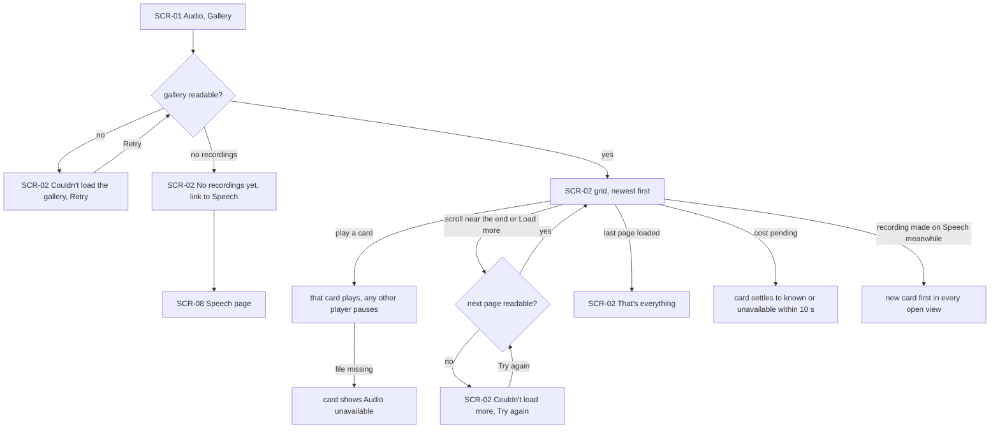
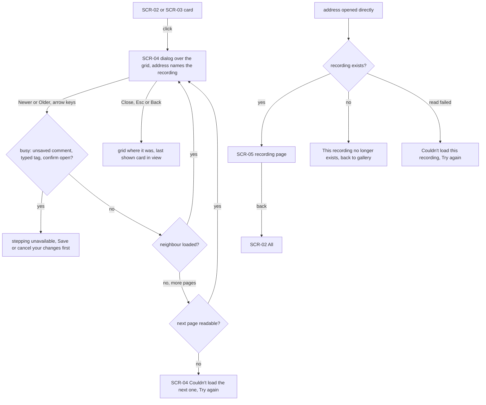
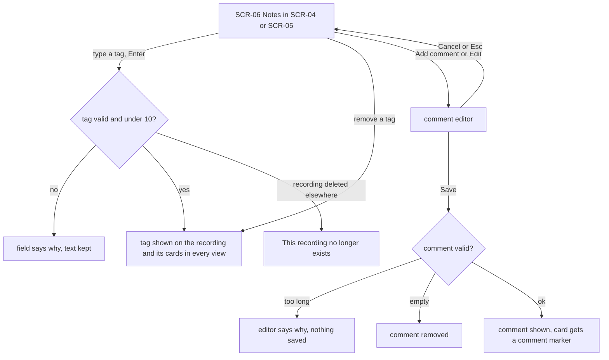
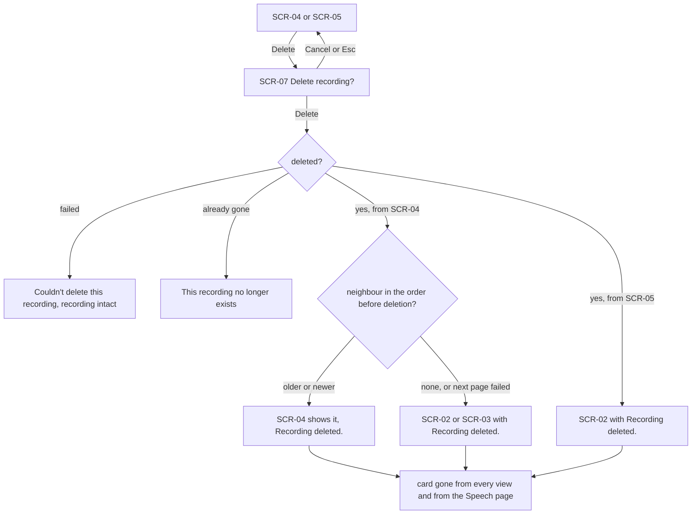
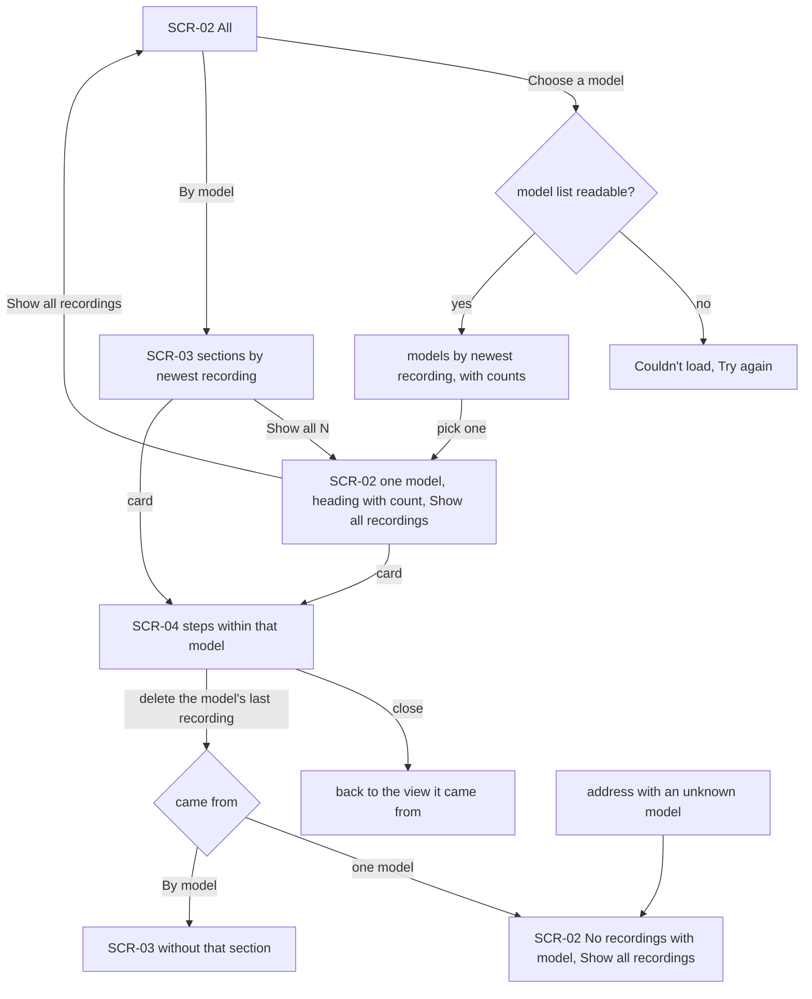
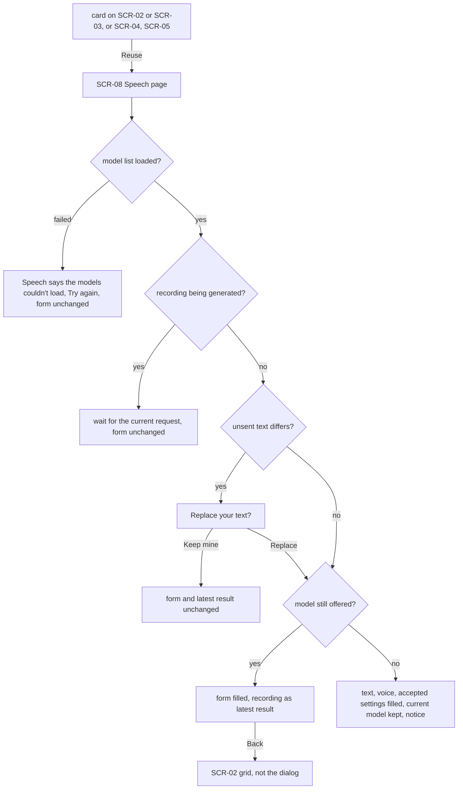

# UX flows — audio-gallery

> User flows for every UI-touching §4 user story of [spec.md](./spec.md). All six stories touch the UI.

## Platform decisions

- **Posture:** desktop-first, per [`design-system.md`](../../design-system.md), the same as the image gallery: the grid is two columns on a narrow window, three from `md` and four from `xl`; the dialog uses two columns from `lg`.
- **Navigation:** a new «Gallery» section in the Audio group, after Speech. A recording's own address is a sibling of the audio gallery's.
- **Modality:** the image gallery's pattern. A plain click on a card opens the recording in a dialog over the grid, and the address changes to the recording's. A direct visit to that address shows a full page. Reuse leaves the gallery for the Speech page; the dialog's history entry is replaced so Back lands on the grid.
- **Tool:** code mode — flows here, inline wireframes in `screens.md`.

## Screen inventory

| ID | Screen | Purpose | Entry | Exit |
|---|---|---|---|---|
| SCR-01 | Navigation bar | the Audio group lists Speech, then Gallery | always visible | any section |
| SCR-02 | Audio gallery — grid («All» or one model) | newest-first recording cards with a player, cost, text, model, voice, settings and tag badges, paging; empty / error / no-such-model states | Audio → Gallery; view switch; «Show all» | card → SCR-04; Reuse → SCR-08; view switch → SCR-03 |
| SCR-03 | Audio gallery — «By model» | one section per model: name, count, four latest cards, «Show all N» | view switch | card → SCR-04; «Show all N» → SCR-02 (one model) |
| SCR-04 | Recording dialog | player, download, full text, model, voice, all settings, times, billed characters, file type, cost; Newer / Older; Notes; Reuse; Delete | a card on SCR-02 or SCR-03 | close → SCR-02/SCR-03; Reuse → SCR-08; Delete → SCR-07 |
| SCR-05 | Recording page | the same details and actions as SCR-04, without stepping, with a way back to the gallery | the recording's address opened directly | back → SCR-02; Reuse → SCR-08; Delete → SCR-07 |
| SCR-06 | Notes card (in SCR-04 / SCR-05) | one comment (Save / Cancel) and tags | always part of SCR-04 / SCR-05 | stays |
| SCR-07 | Delete recording? (confirm) | deletion has no undo | Delete on SCR-04 / SCR-05 | confirm → neighbour in SCR-04, or SCR-02 with notice; cancel → back |
| SCR-08 | Speech page (step 18) | the form filled from the recording, the recording as the latest result; «Replace your text?» when unsent text differs | Reuse | stays |

## Flows

### Flow: US-01 — Browse every recording

The Owner opens Audio → Gallery. If the list can't be read, the page says so with Retry. With no recordings, it says «No recordings yet» and links to the Speech page. Otherwise the grid shows the newest recordings first. Playing a card pauses any other player in the tab; a card whose file is gone shows «Audio unavailable» once the Owner tries to play it. Scrolling near the end, or Load more, reads the next page. If that fails, «Couldn't load more» with Try again appears under the cards, with no automatic retry. After the last page the grid says that's everything. A pending cost settles on its card by itself, and a recording finished on the Speech page meanwhile appears first.

### Flow: US-02 — Open one recording

A click on a card opens the dialog over the grid, and the address names the recording. Newer and Older (or ← →) step through the order the grid loaded; past the last loaded card, the next page is read first, and a failure keeps the dialog on the current recording with Try again. Stepping is unavailable while a comment is being edited, tag text is typed, or the delete confirmation is open. Arrow keys inside a text field or on the focused player never step. Close, Esc or Back returns to the grid with the last shown card in view. Opening the address directly shows the full page, or «This recording no longer exists», or «Couldn't load this recording» with Try again; its way back opens «All».

### Flow: US-03 — Label recordings

In the Notes card the Owner types a tag and presses Enter. An invalid tag, or an eleventh one, is refused with the reason and the typed text stays. A valid tag shows at once on the recording and on its card in every view. Removing a tag works the same way. «Add comment» or «Edit» opens the editor; Cancel or Esc closes it unchanged. Save with too long a text says why. Save with an empty text removes the comment, and a valid one is shown with a marker on the card. If the recording was deleted elsewhere meanwhile, the Owner sees that it no longer exists.

### Flow: US-04 — Remove a recording

Delete opens the confirmation; Cancel or Esc returns. If the deletion fails, the recording stays complete and the page says «Couldn't delete this recording»; if it was already gone, it says so. In the dialog, the neighbour comes from the order as it was before: the next older one (reading the next page if needed), else the newer one, with «Recording deleted.». With no neighbour, or a failed next page, the dialog closes onto the view it came from with the notice. On the full page, the Owner lands on the gallery with the notice. In every case the card leaves every view and the Speech page's recent list and latest result.

### Flow: US-05 — Narrow to one speech model

From «All», the model choice lists every model with recordings, ordered by its newest recording, with counts; if it can't be read, it says so with Try again. Picking one shows that model's grid with a heading, its count and «Show all recordings». «By model» shows a section per model; «Show all N» opens that model's grid. A card opened from either steps only through that model's recordings, and closing returns to where it was opened. Deleting a model's last recording closes onto the view: the model's grid then says «No recordings with <model>», and «By model» has no section for it. An address naming a model without recordings shows the same message.

### Flow: US-06 — Generate again from a recording

Reuse from a card, the dialog or the page opens the Speech page. Once its model list is known, the reuse is applied. If the list can't be loaded, the page says so with Try again and the form stays as it was. While a recording is being generated, the page asks the Owner to wait and changes nothing. Unsent text that differs from the recording's triggers «Replace your text?»; «Keep mine» leaves the form and the latest result alone. Otherwise the form gets the text, model, voice and settings, and the recording becomes the latest result. A model that is no longer offered keeps the current model, with a notice, and the rest is still filled in. Back from the Speech page returns to the grid, not to the closed dialog.

## AC coverage

| AC | Shown by | Notes |
|---|---|---|
| AC-01 | Flow US-01 → grid, paging, That's everything | card contents detailed in screens |
| AC-02 | Flow US-01 → play a card | section leave / dialog pause are app-wide, noted in screens |
| AC-03 | Flow US-01 → error, empty, Audio unavailable branches | |
| AC-04 | Flow US-01 → cost pending | |
| AC-05 | Flow US-02 → dialog, stepping, next page failure, close | |
| AC-06 | Flow US-02 → address opened directly | image addresses unchanged: AC-20 |
| AC-07 | Flow US-03 → tag and comment happy branches | |
| AC-08 | Flow US-03 → refusal branches, deleted elsewhere | |
| AC-09 | Flow US-02 → busy branch | Close / Back / Reuse drop unsaved edits (not blocked) |
| AC-10 | N/A: storage rule, nothing to navigate | covered by integration tests |
| AC-11 | Flow US-04 → deletion branches | |
| AC-12 | Flow US-04 → failed / already gone | |
| AC-13 | Flow US-05 → Choose a model | |
| AC-14 | Flow US-05 → By model | |
| AC-15 | Flow US-05 → unknown model / last deleted | |
| AC-16 | Flow US-06 → Reuse happy path, Back | |
| AC-17 | Flow US-06 → replace, retired model, loading, in-flight | |
| AC-18 | Flow US-01 → new card; Flow US-04 → card gone everywhere | |
| AC-19 | N/A: requests from other sites, no Owner flow | integration test |
| AC-20 | N/A: image gallery regression guard | existing image suites |
| AC-21 | Flow US-05 → counts, sections; Flow US-01 → paging | invariant checked by tests |
