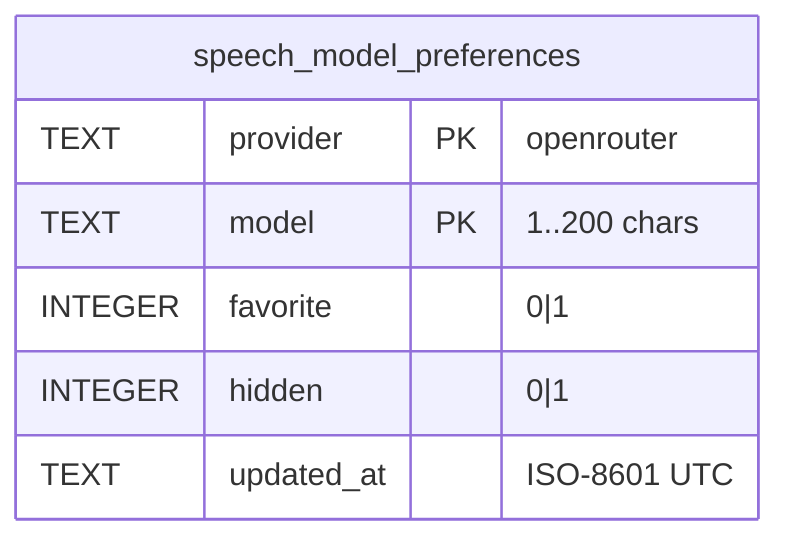

# Data model — models-page-audio

> Sources: spec §5 (AC-02…AC-07, AC-15) + §6, sad.md §4 item 1 / §6.2, ADR-0054.
> Conventions followed (from `migrations/0008`): snake_case, composite natural key, `CHECK` constraints, ISO-8601 UTC text, `IF NOT EXISTS`, paired up/down files.

## Aggregates

| Aggregate root | Owns | Module |
|---|---|---|
| Speech model preference (`speech_model_preferences`, **new**) | favorite + hidden flags of one provider + speech model id | `src/server/modules/models/` |
| Image model preference (`model_preferences`, unchanged) | — | `src/server/modules/models/` |

The two tables are never joined (spec AC-05). Provider balances are **not stored** (spec AC-15) — no table.

## ER

## Fields and constraints

| Column | Type | Constraint | Why |
|---|---|---|---|
| provider | TEXT | `IN ('openrouter')` | speech is OpenRouter-only (step 18); widened by a later migration if a speech provider is added |
| model | TEXT | length 1–200 | same bound as image preferences / shared `ModelId` |
| favorite, hidden | INTEGER | 0/1 | flags |
| updated_at | TEXT | not null | last change |
| — | — | PK (provider, model); `favorite = 1 OR hidden = 1` | one row per model; an all-off row is deleted (ADR-0026 rule) |

## Access patterns

| Query | Statement | Index |
|---|---|---|
| list a provider's speech preferences | `SELECT * … WHERE provider = ? ORDER BY model` | PK prefix |
| read one | `… WHERE provider = ? AND model = ?` | PK |
| upsert / delete | `INSERT … ON CONFLICT (provider, model) DO UPDATE` / `DELETE … WHERE provider = ? AND model = ?` | PK |

Rows are few (≤ a few dozen); no extra index.

## Migrations

Staged here, promoted by `implement` as `migrations/0015_create_speech_model_preferences.{up,down}.sql`:

- `migrations/01_create_speech_model_preferences.up.sql` — `CREATE TABLE IF NOT EXISTS` (additive; touches no existing row).
- `migrations/01_create_speech_model_preferences.down.sql` — `DROP TABLE IF EXISTS speech_model_preferences` (drops only the new table).

## Audit

- Additive only: ✅ (new table, no ALTER on existing tables). Safe for the Owner's live `pnpm dev`.
- Rollback loses only speech preferences: ✅ acceptable (Owner-curated, re-creatable).
- Zod parse on read: repo reuses the `ModelPreference` row parser (provider value `openrouter`).
