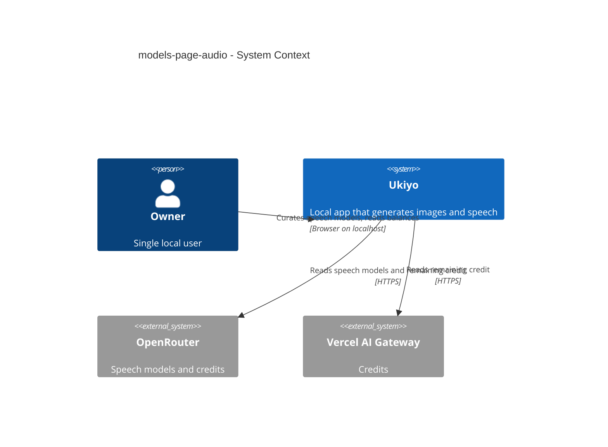
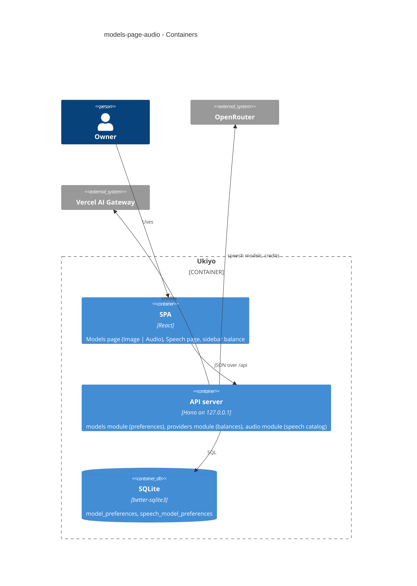
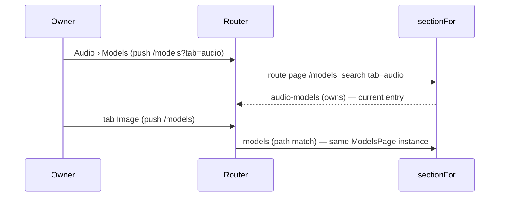

# Software Architecture Document — models-page-audio

## 1. Introduction and goals

**Intent.** The Models page gains an Audio view (every OpenRouter speech model with price, limit, voices, controls, ★ and «Show in picker») whose preferences shape the Speech page's model list, and the navigation bar shows each configured provider's remaining balance on every page from one shared read (spec §1 ¶3, §2).

**Top-3 quality goals (1-liners; full scenarios in §10):**
1. **Kept apart** — speech-model and image-model preferences never touch each other (AC-05), and the Image view is the step-10 page unchanged (AC-10).
2. **One balance read per provider** — the navigation bar and the Speech page read the same cached per-provider answers; triggers coalesce; a hung provider never delays the other (spec §6).
3. **Honest balance** — the provider's own figure or «—», never $0 and never a computed number; the key stays on the server (AC-12, AC-14, AC-15).

**Stakeholders.**

| Role | Interest | Sign-off owner? |
|---|---|---|
| Owner (also Tech Lead for SAD approval) | curates speech models, watches spend | Yes |

## 2. Constraints

**Technical.** Same stack. Sections are registry entries (ADR-0022) with group (ADR-0046) and `owns` (ADR-0048); preference writes check the catalog only when turning a flag on (ADR-0029) through one per-flag optimistic mutation (ADR-0030); speech sits behind its own port and catalog (ADR-0039); the speech catalog's `peek()` never fetches (ADR-0052). Provider HTTP via plain `fetch` inside adapters (CLAUDE.md). The owner's `pnpm dev` (`tsx watch`) applies pending migrations on its next restart, and the runner refuses a half pair — so the migration is promoted as a finished pair, `.down.sql` first, with `CREATE TABLE IF NOT EXISTS` (0008 precedent); once promoted it is never edited.
**Organisational.** Solo maintainer; local gate only; one PR (#8) for the audio epic.
**Conventions.** CLAUDE.md: shadcn/ui primitives (Tabs and Tooltip are already in `components/ui/`); shared zod schemas in `src/shared/`; `AppError`; never branch on provider inside a feature module — the balance read is an adapter capability.
**Regulatory / external.** OpenRouter publishes the key's credits (purchased total and usage); Vercel AI Gateway publishes the team's remaining balance and total used (REST reference, checked 2026-10-25). Both need the key → server-only.

## 3. Context and scope

Ukiyo's browser pages read speech models, speech-model preferences and provider balances from the local server; the server reads the speech catalog (cached, existing) and, per balance read, each configured provider's credit endpoint.

**External systems (in / out):**

| Actor or system | Type | Interaction |
|---|---|---|
| Owner | Person | opens Models (Image / Audio), toggles speech-model ★ / «Show in picker», sees balances |
| OpenRouter | System (external) | speech model list (existing, cached); credits read (key) |
| Vercel AI Gateway | System (external) | credits read (key) |

**C4 Context (L1):**



## 4. Solution strategy

**Target surface:** `[web-frontend, backend-service]`.

1. **Speech-model preferences in their own table, same module, same contract shape** — a new `speech_model_preferences` table (migration 0015, additive) mirroring `model_preferences`; the models module's repo is parametrized by kind; the existing preference read/write gain an optional `kind` (`image` default, `speech`) so the image contract is unchanged; a speech write that turns a flag on is checked against the speech catalog → [ADR-0054](./adr/0054-keep-speech-model-preferences-in-their-own-table-behind-the-same-preference-operations.md).
2. **Balance as an optional provider-adapter capability, read per provider** — `ImageProvider.balance?()` implemented by the OpenRouter and Vercel adapters; `GET /api/providers/{providerId}/balance` answers `{ provider, remainingUsd }` with `remainingUsd: null` when the provider fails, times out (10 s) or answers something unparseable (unknown provider → not found; not configured → not configured, like the models route); the speech adapter's own `credits()` and `GET /api/audio/credits` are removed → [ADR-0055](./adr/0055-read-provider-balances-through-the-image-adapters-one-read-per-provider.md).
3. **One query per provider in the browser, shared** (inline): `useProviderBalance(id)` (key `["provider-balances", id]`, `refetchInterval` 5 min, `refetchIntervalInBackground: false`, `refetchOnWindowFocus: "always"`, `retry: false`) is used by the sidebar (one per configured provider from the existing `["providers"]` query) and by the Speech page (OpenRouter). Triggers go through `refreshBalances(qc)`: a provider whose read is in flight gets a dirty mark and exactly one refetch when it settles; otherwise it refetches now (`cancelRefetch: false`, so nothing is aborted or doubled). Triggers: the job leaving `running` (any end), a speech request settling. A failed read shows «—» (`isError` wins over kept `data`). «Not configured» on the Speech page comes from `["providers"]` (`configured: false` for openrouter; loading or failed providers read ≠ not configured).
4. **Tab = address; two sections for one page** — `/models` (Image) and `/models?tab=audio` (Audio); the registry gets a second section `audio-models` (group audio, label «Models», `accessibleName: "Audio models"`; the image `models` entry keeps its name) whose `owns` is `route.name === "page" && trimSlash(route.pathname) === "/models" && new URLSearchParams(route.search).get("tab") === "audio"`; the alias rule compares `current.path` up to its `?` with the pathname, so `/models?tab=audio` is never «aliased» → [ADR-0056](./adr/0056-let-one-page-serve-two-sections-by-a-query-parameter.md).
5. **Speech picker arrangement in a pure function; the automatic pick pinned once** (inline): `arrangeSpeechModels(models, prefs, selected)` → `{ favorites, makers[] }`: favorites first in the Speech order (maker order, then catalog order); hidden models dropped — even favorites — except the selected one, which sits at the top of its maker group (never in Favorites) marked «Hidden». `useSpeechDraft` keeps the full catalog (Reuse of a hidden model works; a retired one keeps step 18's notice) and stops falling back to `models[0]` on every render: once the catalog and the preferences have settled (or the preferences failed, or 1.5 s passed — GeneratePanel's `PREFS_WAIT_MS` precedent), an empty or no-longer-offered `modelId` is pinned to the first favorite, else the first visible model, else the first model. From then on the selection only changes by the Owner or a Reuse. An unreadable preference list = step-18 list.
6. **Audio view reads the cached catalog and its own preference keys** (inline): it reads `SPEECH_MODELS_KEY` with the Speech page's 10-minute `staleTime` (no extra catalog read) and «not configured» from `["providers"]`. Speech-preference hooks use their own roots — query `["speech-model-preferences", provider]`, mutation `["set-speech-model-preference", provider]` — so the per-flag «last sibling settles → refetch» rule (ADR-0030) never mixes image and speech.
7. **Audio view reuses the image table's pieces** (inline): the Row's ★/Switch cells, «No longer offered» and the save-failure handling move into small shared components (`PreferenceToggles`, `RetiredPreferences`) used by both views; the Image view's markup and behaviour stay the same (its tests unchanged).

## 5. Building block view

**C4 Container (L2):**



| Block | Responsibility | Change |
|---|---|---|
| `migrations/0015_create_speech_model_preferences` | the new table | new |
| `modules/models/repo.ts` | `createModelsRepo(db, now, kind)` — table by kind | changed |
| `modules/models/routes.ts` | `kind` on read/write; speech writes checked against the speech catalog | changed |
| `modules/providers/port.ts` | `balance?(signal): Promise<number>` | changed |
| `modules/providers/openrouter.ts`, `vercel.ts` | credit reads | changed |
| `modules/providers/routes.ts` | `GET /providers/{id}/balance` | changed |
| `server/app.ts` | speech registry + catalog hoisted above the models routes; one instance shared with the audio service (warm cache) | changed |
| `modules/providers/openrouter-speech.ts`, `speech-port.ts`, `modules/audio/*` | drop `credits()` and its route | changed |
| `shared/models.ts`, `shared/providers.ts` | `PreferenceKind`, `BalanceResponse` | changed |
| `web/features/models/` | tabs, `AudioModels`, shared toggle pieces, kind-aware preference hooks | changed |
| `web/features/audio/ModelSelect.tsx`, `useSpeechDraft.ts`, `SpeechPage.tsx` | favorites/hidden, shared balance | changed |
| `web/components/app-sidebar.tsx` + `ProviderBalances` | balance list | changed / new |
| `web/sections.tsx`, `App.tsx` | `audio-models` section, alias rule | changed |
| `web/features/generate/GeneratePanel.tsx` | invalidate balances when a job ends | changed |

## 6. Runtime view

### 6.1 Balance read (AC-11…AC-15)

```mermaid
sequenceDiagram
    participant SPA as SPA (sidebar + Speech page)
    participant API as Providers routes
    participant AD as Provider adapter (OpenRouter / Vercel)
    Note over SPA: one query per configured provider; refreshBalances coalesces triggers
    SPA->>API: read balance (provider)
    alt unknown provider
        API-->>SPA: not found
    else not configured
        API-->>SPA: not configured
    else configured
        API->>AD: balance() with a 10 s deadline
        alt answers
            AD-->>API: OpenRouter total_credits − total_usage / Vercel Number(balance)
            API-->>SPA: remainingUsd
        else hangs / refuses / unparseable
            AD-->>API: error or timeout
            API-->>SPA: remainingUsd null
        end
    end
    Note over SPA: «$12.34» / «—»; each provider's figure independent
```

Triggers: the job leaving `running` (GeneratePanel), a speech request settling (SpeechPage), every 5 min while visible, window focus. A trigger during an in-flight read marks the query dirty; it is refetched once when the read settles (no abort — `request()` carries no signal, so an abort would not stop the HTTP call anyway).

### 6.2 Speech preference write (AC-02, AC-06, AC-07)

```mermaid
sequenceDiagram
    participant SPA as Audio view / Speech list
    participant API as Models routes
    participant SC as Speech catalog
    participant DB as speech_model_preferences
    SPA->>SPA: optimistic flag change (key speech-model-preferences)
    SPA->>API: set preference (kind speech, model, flag)
    alt turns a flag on
        API->>SC: models("openrouter")
        alt catalog unreadable / not configured
            API-->>SPA: provider error / not configured
        else model not offered
            API-->>SPA: unknown model
        end
    end
    API->>DB: upsert, or delete when both off
    API-->>SPA: stored preference
    alt error
        SPA->>SPA: roll back that flag; «Couldn't save — try again.»
    end
```

### 6.3 Tabs and the current entry (AC-09)




## 7. Deployment view

Unchanged: one Node process on `127.0.0.1`; the migration applies on boot (and by the Owner's running `pnpm dev` when the file lands).

## 8. Crosscutting concepts

- **Wording:** heading «OpenRouter · N speech models»; maker column = the catalog's maker; price `priceText` and limit `limitText` from step 18; voices «N voices» / «1 voice» / «provider default» (no named voices); controls = the models' control labels lower-cased, joined «, », or «—»; balance `$` + two decimals, «…» loading, «—» unavailable (tooltip «Balance unavailable»); the Speech page line shows «— credits remaining» when the sidebar shows «—».
- **Errors:** a configured provider failing its balance read is not an error answer — 200 with `remainingUsd: null`.
- **Security:** keys only inside adapters; the balance answer carries a number or null, never provider text.

## 9. Architecture decisions

- [ADR-0054](./adr/0054-keep-speech-model-preferences-in-their-own-table-behind-the-same-preference-operations.md) — speech-model preferences in their own table behind the same operations.
- [ADR-0055](./adr/0055-read-provider-balances-through-the-image-adapters-one-read-per-provider.md) — balances as an adapter capability, read per provider, the speech credits route removed.
- [ADR-0056](./adr/0056-let-one-page-serve-two-sections-by-a-query-parameter.md) — one page, two sections, matched by a query parameter.

## 10. Quality requirements

| Scenario | Stimulus | Response | Measure |
|---|---|---|---|
| Kept apart | the Owner stars a speech model whose id is also an image model | only the speech row changes | integration test |
| Image view unchanged | existing Models page tests | pass unchanged | `web` suite |
| One balance read | sidebar + Speech page mounted, a recording settles | one request per provider; two triggers during a read → exactly one follow-up | component test |
| Foreign page | balance read / speech-kind preference write from another origin | refused, nothing changes; the balance answer holds only `provider` + `remainingUsd` | integration test |
| Hung provider | Vercel credit read never answers | OpenRouter figure shown without waiting; Vercel «—» after ≤ 10 s | integration test with a hanging fake + component test |
| Interval | 5 min pass, tab visible / hidden | one read / none | component test with fake timers |
| Migration | DB at 0014 with image preferences | 0015 applies, rows unchanged; rollback drops only the new table | migration test + ship check on a copy of the Owner's data |

## 11. Risks and technical debt

- **OpenRouter credits for a limited key:** `/credits` reports the account's credits; a key with its own spend limit isn't reflected. Accepted — matches step 18's line.
- **Vercel answers strings** (`"95.50"`): parsed with `Number()`; a non-finite value → null («—»).
- **Two sections for one page** is a small registry special case; documented in ADR-0056.
- **Duplicated toggle markup (review 2026-10-25 R4):** §4 item 7 planned shared `PreferenceToggles` / `RetiredPreferences`; the Audio view repeats the image table's ★ / switch cells and the «No longer offered» block instead, so the step-10 Image view stays byte-for-byte unchanged (AC-10). Debt: a fix to the per-model save/forget handling must be made in both `ModelsPage.tsx` and `AudioModels.tsx` — extract the shared pieces when either is next touched.

## 12. Glossary

See [CONTEXT](../../../CONTEXT.md): Provider balance, Favorite model, Hidden model, Model preference, Speech model, Section.
