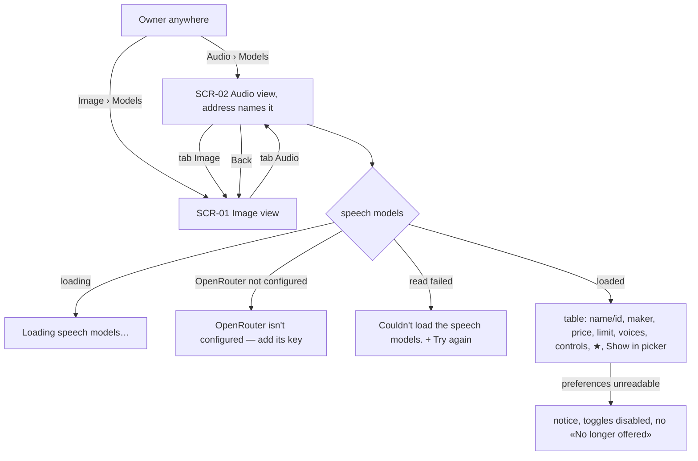
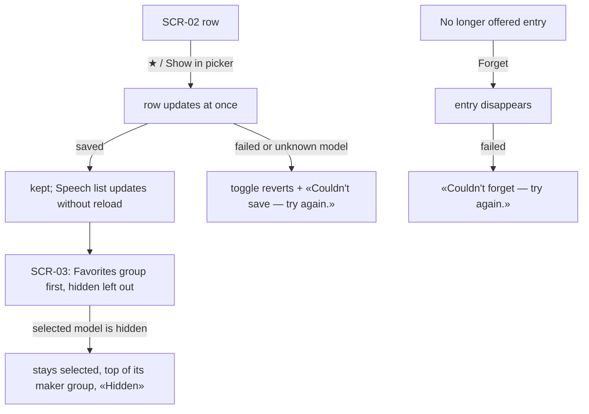
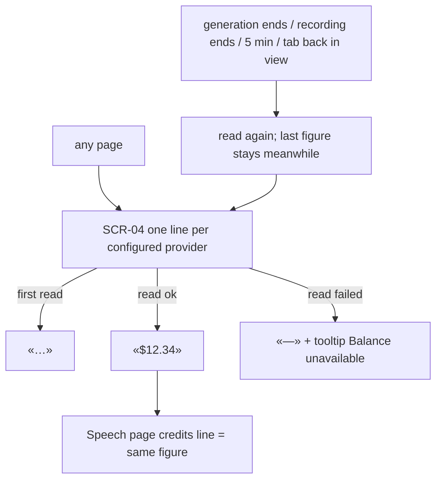

# UX flows — models-page-audio

## Screen inventory

| SCR | Screen | Notes |
|---|---|---|
| SCR-01 | Models page — Image view | the step-10 page under an «Image \| Audio» tab list; unchanged body |
| SCR-02 | Models page — Audio view | OpenRouter speech-model table + «No longer offered» |
| SCR-03 | Speech page — model list (popover) | step 18's list with a «Favorites» group and hidden models left out |
| SCR-04 | Navigation bar — provider balances | in the sidebar footer on every page; the Speech page's credits line reads the same figure |

## US-01 / US-03 — open the Audio view and compare

## US-02 — curate speech models

## US-04 / US-05 — balances

## AC → flow map

| AC | Flow |
|---|---|
| AC-01, AC-08, AC-09, AC-10 | US-01 / US-03 |
| AC-02 … AC-07 | US-02 |
| AC-11 … AC-15 | US-04 / US-05 |
