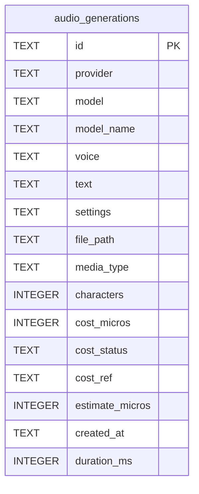

# Data model — text-to-speech

> Sources: spec §5 (AC-03, AC-09, AC-10, AC-13, AC-15, AC-16, AC-18), sad.md §5/§6/§8, ADR-0042…0044.
> Conventions followed (detected from `migrations/0002`, `0005`, `0011` and `architecture-map.md` §Conventions):
> TEXT ULID primary keys, snake_case, `CHECK` constraints, ISO-8601 UTC text timestamps, hard delete,
> money as integer `cost_micros` + `cost_status` tied by a CHECK, JSON as TEXT, relative file paths only.

## Aggregates

| Aggregate root | Owns | Module |
|---|---|---|
| Recording (`audio_generations`) | its audio file (`file_path`), settings JSON, cost | `src/server/modules/audio/` |

No foreign keys this step. Steps 19 (tags, comments) and 21 (voice presets) add child tables keyed by `audio_generations.id` (`ON DELETE CASCADE`, mirroring `generation_tags` / `generation_comments`).

## ER

## Entities

### audio_generations (rebuilt; 0011 shape → this shape)

| Column | Type | Null | Constraint / meaning | Change vs 0011 |
|---|---|---|---|---|
| id | TEXT | no | PK, ULID minted when the answer arrives | — |
| provider | TEXT | no | 1–32 chars; `'openrouter'` | new (prototype rows: `'openrouter'`) |
| model | TEXT | no | 1–100 chars, provider model id | — |
| model_name | TEXT | yes | 1–200 chars, catalog name at save time (AC-15); NULL = prototype row → display falls back to the family spec name, then the id | new |
| voice | TEXT | yes | 1–100 chars; NULL = provider default voice (AC-09) | NOT NULL → nullable |
| text | TEXT | no | `length(trim(text)) > 0` | CHECK tightened (prototype texts are trimmed — verified on the copy) |
| settings | TEXT | no | JSON: only the settings sent, incl. `instructions` | — |
| file_path | TEXT | no | UNIQUE, `audio/<id>.<ext>` | — |
| media_type | TEXT | no | `audio/mpeg` \| `audio/wav` (ADR-0041) | CHECK added (prototype rows are all `audio/mpeg`) |
| characters | INTEGER | no | ≥ 0, billed characters (code points of trimmed text) | — |
| cost_micros | INTEGER | yes | ≥ 0 | — |
| cost_status | TEXT | no | `known` \| `pending` \| `unavailable`; `(cost_status='known') = (cost_micros IS NOT NULL)` | new (prototype: `known` if amount else `unavailable`) |
| cost_ref | TEXT | yes | OpenRouter generation id | — |
| estimate_micros | INTEGER | yes | ≥ 0, up-front estimate (ADR-0043, spec §8 Q2) | new (prototype: NULL) |
| created_at | TEXT | no | ISO-8601 UTC | — |
| duration_ms | INTEGER | yes | ≥ 0, request sent → audio received | new (prototype: NULL) |

## Indexes

| Index | Columns | Query it serves |
|---|---|---|
| PK `id` | id | recent recordings `ORDER BY id DESC LIMIT 10` (flow 5); get by id (file, delete, cost resolve) |
| UNIQUE `file_path` | file_path | integrity: one file per recording (implicit, kept from 0011) |
| `audio_generations_cost_pending` (partial) | id `WHERE cost_status = 'pending'` | boot resume `listPendingCosts` (flow 7) — mirrors `generations_cost_pending` |

No model index yet — the per-model filter is step 19's query.

## Migrations (staged)

| Ordinal | Files | What |
|---|---|---|
| 01 | `migrations/01_rebuild_audio_generations.{up,down}.sql` | create `audio_generations_v2` → copy every row → drop → rename → partial pending index. `down` rebuilds the 0011 shape (provider-default voice → `'default'`). |

Not a breaking change for any consumer: the only reader is this module, which ships together with the migration. A rebuild (not expand/contract) because SQLite can't relax NOT NULL or change a CHECK in place.

## Test fixtures

- `tests/helpers/recordings.ts` (new): `seedRecording(db, dataDir, overrides)` inserts a row + writes a small file, like `tests/helpers/generations.ts` `seedGeneration`.
- Migration test: build a DB migrated to 0011, insert prototype-shaped rows (incl. one with `cost_micros` NULL), apply 0012 → assert statuses, amounts, voices, files; roll back → assert the 0011 shape.

## Drift

The domain layer (`src/server/modules/audio/repo.ts` zod `Row`) is rewritten with this migration. Drift against the **new** schema is checked at implement; against the old one it is intentional (every new column is missing from the prototype's `Row`).
