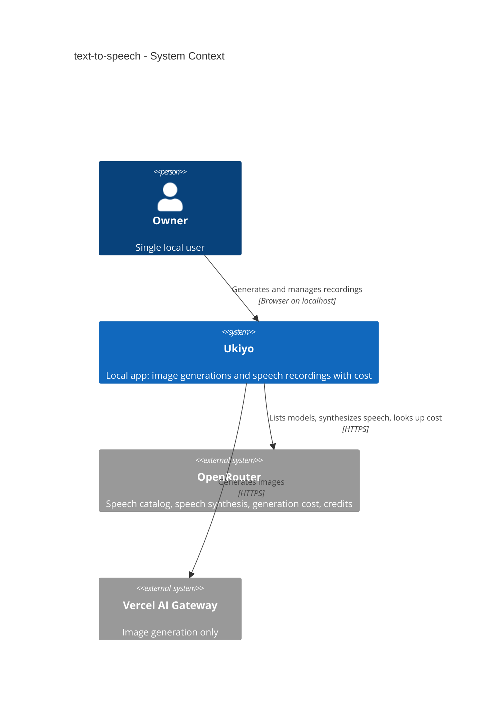
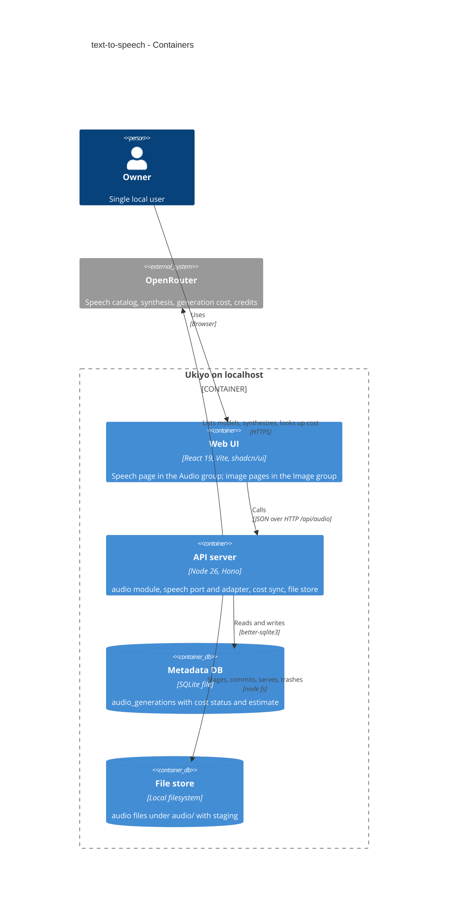
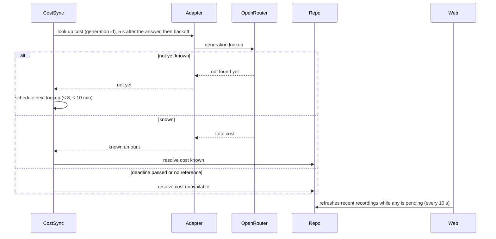
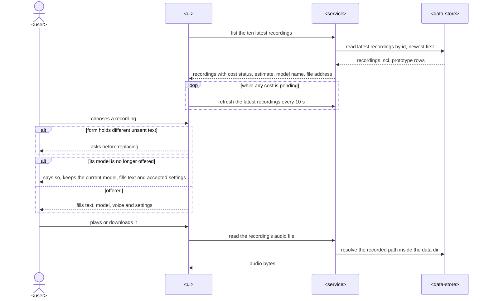
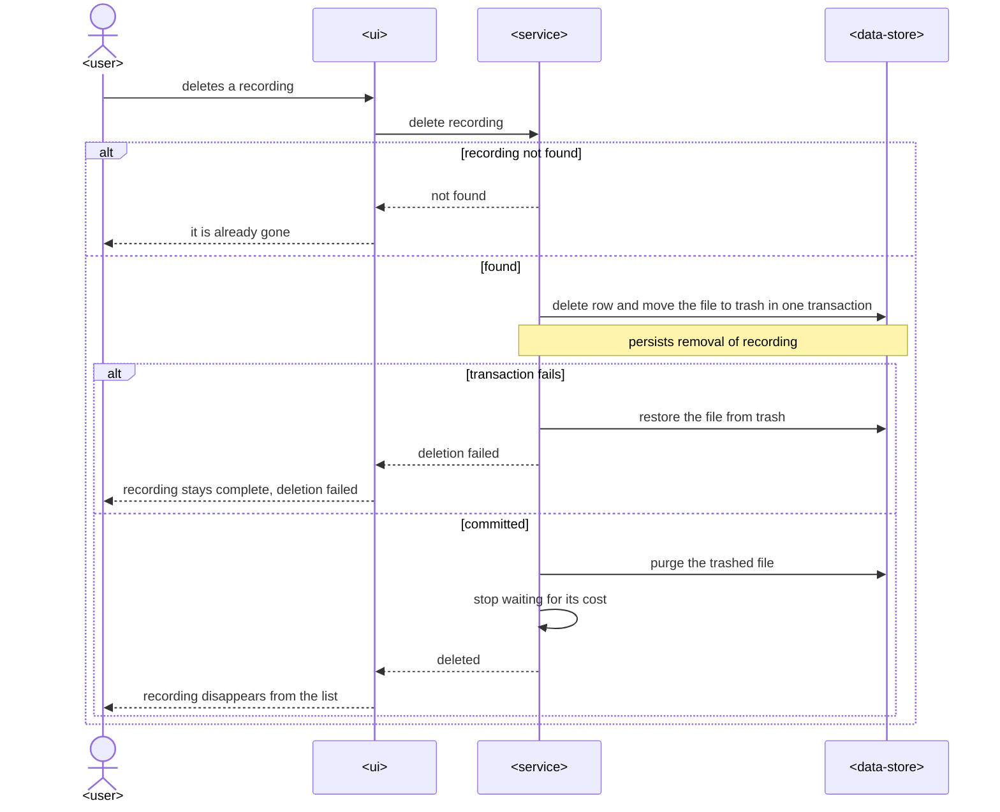
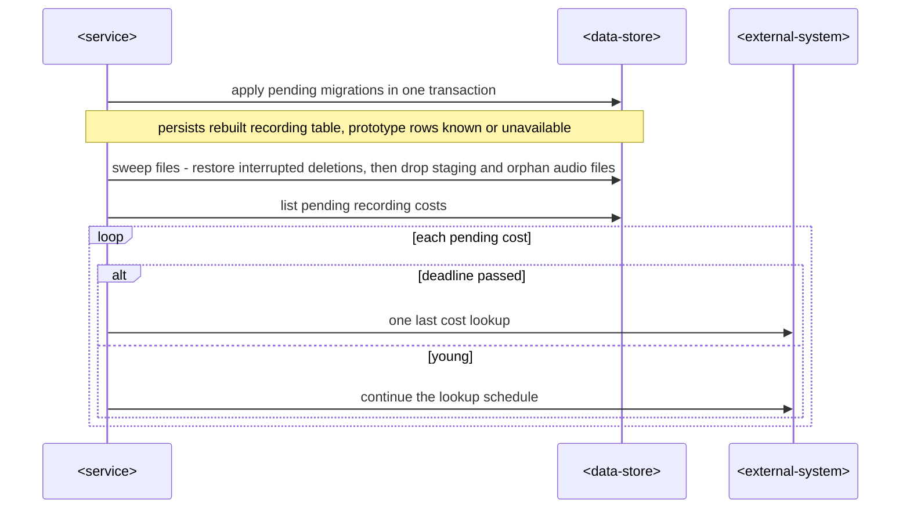

# Software Architecture Document — text-to-speech

## 1. Introduction and goals

**Intent.** Turn the audio prototype into a first-class part of Ukiyo (spec §2): the navigation gets an Image and an Audio group, and the Speech page offers every OpenRouter speech model, each with the controls it accepts. Every recording is saved with an honest cost, which is estimated before the request and confirmed later through OpenRouter's generation lookup. The prototype's 19 recordings survive unchanged. The structure has to carry steps 19–21: the audio gallery with tags and comments, audio on the Models page, and voice presets.

**Top-3 quality goals (1-liners; full scenarios in §10):**

1. **Honest cost** — a recording never shows $0 for an unknown cost; it is `pending` → `known`/`unavailable` within bounded lookups, and the estimate is always labelled (spec AC-11…AC-13, §6).
2. **Durable, atomic recordings** — a recording is never a row without its file or a file without its row, and the prototype rows and files are 100 % preserved (spec AC-10, AC-16, AC-18, AC-20, §6).
3. **Provider isolation** — each speech model family's differences (controls, voices, output format, pricing unit) live in one adapter and one shared spec map. The speech service never branches on the provider, and image behaviour is unchanged (spec AC-07…AC-09, AC-14; ADR-0002).

**Stakeholders.**

| Role | Interest | Sign-off owner? |
|---|---|---|
| Owner | generates speech, tracks spend, keeps the prototype recordings | Yes (solo project: also Tech Lead) |
| Tech Lead | SAD approval | Yes |

**Decision overrides (¶4).**
- Decision override: architecture choices in this SAD were made by the pipeline agent under the owner's standing instructions (provider adapter behind a port, separate audio tables, file store, cost-sync reuse, grouped navigation, data safety), not walked one by one with the owner. Rationale: the owner delegated them in the run brief (2026-10-25); each is recorded as an ADR for review.

## 2. Constraints

**Technical.**
- TypeScript 5.9 / Node 26, Hono 4.13, React 19.3 + Vite 8, Tailwind v4 + shadcn/ui, TanStack Query 5, SQLite via better-sqlite3 13, zod 4 — [ADR-0001](../../adr/0001-use-typescript-node-hono-react-stack.md), [ADR-0003](../../adr/0003-store-metadata-in-sqlite-and-images-on-disk.md).
- Provider calls go through a port in `src/server/modules/providers/`, use plain `fetch` and no vendor SDK — [ADR-0002](../../adr/0002-organize-as-modular-monolith-with-provider-port.md). `CLAUDE.md` names only `ImageProvider`; ADR-0039 adds `SpeechProvider` next to it (a convention extension, flagged for the owner).
- OpenRouter speech API (read 2026-10-25): `POST /api/v1/audio/speech` takes `model`, `input`, `voice`, `response_format` (`mp3` | `pcm`, default pcm), `speed`, `instructions` and `provider.options.<slug>`. It answers with raw audio bytes; a PCM answer's content type carries `rate` and `channels`; the generation id comes in the `X-Generation-Id` header. HeyGen and Gemini answer PCM only; MiniMax and Voxtral answer mp3 only. `GET /api/v1/models?output_modalities=speech` is public and gives the id, the name, `pricing.prompt` (per character), `pricing.completion` (per second or per token), `supported_voices` and `context_length`. `GET /api/v1/generation?id=` (Bearer key) gives `total_cost`, with `api_type` including `tts`.
- Migration `0011_create_audio_generations` is applied to the owner's DB holding 19 rows and 19 files under `data/audio/`. It is treated as shipped: kept byte-for-byte, and every schema change goes in a new migration that migrates those rows.
- Image modules (`generations`, gallery, image providers) are shipped; this step may change only shared building blocks (file store, cost sync, section registry), and never their observable behaviour.

**Organisational.** Solo maintainer; local gate `pnpm typecheck && pnpm lint && pnpm test`; no CI. The whole audio epic (steps 18–21) lands on `feature/audio-generation` as one PR. Ship verification may make ≤ 3 real speech calls, each with ≤ 80 characters.

**Conventions.** `CLAUDE.md` + [`architecture-map.md` §Conventions](../../architecture-map.md): `createApp(deps)` wiring, `AppError` envelope, ULIDs, repo + zod row parsing, `cost_micros` + `cost_status`, paired migrations, shared zod DTOs, shadcn/ui.

**Regulatory / external.** N/A — a local single-user tool; texts go only to the provider the Owner picks.

## 3. Context and scope

The Owner, on their own machine, types text in Ukiyo's Speech page; Ukiyo sends it to OpenRouter with the chosen speech model and voice, saves the returned audio and its metadata locally, and later asks OpenRouter what the request actually cost.

<!-- brownfield: architecture-map.md reflects cbb9c47 (= HEAD of this branch before this step); modules generations/providers/models/storage/system/audio (prototype) as listed there. -->

**External systems (in / out):**

| Actor or system | Type | Interaction |
|---|---|---|
| Owner | Person | types text, picks model/voice/controls, plays, downloads, reuses, deletes recordings |
| OpenRouter | System (external) | speech catalog (public), speech synthesis, generation cost lookup, credit balance (Bearer key) |
| Vercel AI Gateway | System (external) | unchanged — images only; not used by audio |

**C4 Context (L1):**



## 4. Solution strategy

**Target surfaces:** `backend-service` (the Hono API) + `web-frontend` (the existing React SPA). UI architecture: the existing client-rendered SPA with the hand-written History router (ADR-0009, ADR-0022). It is unchanged, so no new ADR.

**Top strategic choices (the seeds for ADRs):**

1. **A speech port next to the image port** — a `SpeechProvider` port in `providers/`, with an OpenRouter speech adapter that owns every wire detail: the catalog, voices, output format, `provider.options`, credits, the cost lookup and PCM→WAV wrapping. The audio module talks only to the port, through a small speech registry keyed by provider id → [ADR-0039](./adr/0039-put-speech-behind-its-own-provider-port-with-an-openrouter-adapter.md).
2. **Model capabilities from a known-family spec map, safe fallback** — the catalog says little: `supported_parameters` is empty for every speech model. So `src/shared/speech-models.ts` maps model families (id prefix, plus per-id overrides) to controls, ranges, char limits, output format, voice requirement and pricing unit. Any other model gets voice + text only → [ADR-0040](./adr/0040-describe-speech-model-controls-with-a-family-spec-map-and-a-voice-and-text-fallback.md); playable output → [ADR-0041](./adr/0041-request-mp3-where-offered-and-wrap-raw-pcm-as-wav-in-the-adapter.md).
3. **Same guarantees as images, by reusing their building blocks** — recordings are saved through the existing file store (stage → commit in the DB transaction → boot sweep; delete via trash) → [ADR-0042](./adr/0042-save-recordings-through-the-file-store-with-a-single-file-staging-path.md). Costs are resolved by the existing cost-sync resolver, generalised over its repo and lookup → [ADR-0043](./adr/0043-resolve-recording-costs-with-the-shared-cost-sync-resolver-and-keep-the-estimate-beside-the-cost.md). The schema change is one new migration that rebuilds `audio_generations` and keeps every prototype row → [ADR-0044](./adr/0044-rebuild-the-audio-table-in-a-new-migration-keeping-prototype-rows-as-known-cost.md).
4. **Synchronous speech requests, kept-mounted page** — speech answers in seconds, so `POST` waits for the audio and returns the saved recording; no job slot. The Speech page stays mounted like Generate, so an in-flight request and its outcome survive moving between sections (spec AC-02, AC-17) → [ADR-0045](./adr/0045-generate-speech-synchronously-in-the-request-and-keep-the-speech-page-mounted.md).
5. **Section groups in the one registry** — each `Section` gets a `group` (`image` | `audio`) and optional `aliases`; the sidebar renders one `SidebarGroup` per group, and audio addresses live under `/audio/` → [ADR-0046](./adr/0046-group-sections-in-the-registry-and-put-audio-addresses-under-audio.md).

## 5. Building block view

Modular monolith (ADR-0002). The audio module is rebuilt in the layered shape of `generations`: routes → service → repo/domain, with the provider behind the port. The cross-cutting blocks are shared, not copied: file store, cost sync, request guard.

**Internal decomposition:**

```
src/shared/
├── speech.ts           Recording DTOs, StartSpeechRequest, VoiceSettings, billedChars (new; replaces the prototype's audio.ts)
└── speech-models.ts    family spec map, SpeechModel DTO, pricing unit, settingsFor (new)
src/server/modules/
├── providers/
│   ├── speech-port.ts        SpeechProvider, SpeechResult, SpeechCostLookup (new)
│   ├── openrouter-speech.ts  OpenRouter speech adapter: models, speak, credits, lookupCost (moved + rewritten)
│   └── speech-catalog.ts     10-min cached speech model list per provider (new)
├── audio/
│   ├── routes.ts      registerAudioRoutes — thin HTTP layer (rewritten)
│   ├── service.ts     validate against the model, speak, save atomically, track cost, delete (new)
│   ├── domain.ts      estimate, cost-from-result, model display name, recording → DTO (new)
│   ├── wav.ts         raw PCM → WAV container, used by the save step (new)
│   └── repo.ts        recordings SQL + zod rows, pending costs, resolveCost (rewritten)
├── generations/cost-sync.ts   generalised: repo + lookup injected (edited, behaviour unchanged)
└── storage/file-store.ts      + single-file staging for audio (edited)
migrations/0012_rebuild_audio_generations.{up,down}.sql   (new — staged by data-model)
src/web/
├── sections.tsx / components/app-sidebar.tsx   groups + aliases (edited)
└── features/audio/   SpeechPage, SpeechForm, VoiceControls, ModelSelect, VoiceSelect,
                      SpeechResult, RecentRecordings, speechCost (split from the prototype)
```

**C4 Container (L2):**



## 6. Runtime view

Participants: Owner, Web (Speech page), Routes (audio routes), Service (audio service), Catalog (speech catalog), Adapter (OpenRouter speech adapter), Files (file store), Repo (audio repo + DB), CostSync, OpenRouter.

**Critical flow 1: generate and save a recording** (spec AC-03, AC-04, AC-05, AC-10, AC-13, AC-20)

```mermaid
sequenceDiagram
    actor Owner
    participant Web
    participant Service
    participant Catalog
    participant Adapter
    participant OpenRouter
    participant Files
    participant Repo
    participant CostSync
    Owner->>Web: types text, picks model, voice, controls, generates
    Web->>Service: start speech (text, model, voice, settings)
    Service->>Catalog: find model
    alt model unknown or text over its limit or empty
        Service-->>Web: refused with the reason
        Web-->>Owner: plain message, form kept
    else valid
        Service->>Adapter: speak (only the model's accepted settings)
        Adapter->>OpenRouter: synthesize speech
        alt refused, failed, timed out or no audio
            OpenRouter-->>Adapter: error or nothing
            Adapter-->>Service: provider error
            Service-->>Web: provider error (timeout: may still be charged)
            Web-->>Owner: plain message, form kept
        else audio
            OpenRouter-->>Adapter: audio bytes + generation id
            Adapter-->>Service: audio, media type, stated cost or none, generation id
            Service->>Service: wrap raw PCM as WAV when needed
            Service->>Files: stage the audio file
            Service->>Repo: insert recording (cost known if stated, else pending with a generation id, else unavailable; estimate) and commit file in one transaction
            alt conversion or save fails
                Service->>Files: discard staged file
                Service-->>Web: storage error (audio arrived, may be charged)
                Web-->>Owner: plain message, form kept
            else saved
                Service->>CostSync: track the cost when pending (generation id)
                Service-->>Web: saved recording
                Web-->>Owner: player starts, recording first in recent
            end
        end
    end
```

**Critical flow 2: cost reconciliation** (spec AC-13, §6 Cost lookups)



**Critical flow 3: delete a recording** (spec AC-16) — the service runs one transaction: delete the row, then `trashAudioSync` moves the file into staging as the last step. After commit it purges the file and calls `costSync.forget(id)`. If the transaction fails, `restoreAudioSync` puts the file back and the Owner sees «deletion failed».

### Flow 4: open the Speech page and choose a model (spec AC-01, AC-06, AC-07, AC-08, AC-09, AC-11, AC-12, AC-14)

```mermaid
sequenceDiagram
    actor user as <user>
    participant ui as <ui>
    participant service as <service>
    participant ext as <external-system>
    Note over ui: Precondition - the Audio group is shown after the Image group; the former Speech address is replaced by the new one
    user->>ui: opens Speech in the Audio group
    ui->>service: list speech models
    alt catalog cached for under 10 minutes
        service-->>ui: models with controls, voices, limits, pricing unit
    else cache cold
        service->>ext: read the public speech catalog
        ext-->>service: models, voices, prices, stated limits
        service->>service: apply the family spec map, fallback voice and text only
        service-->>ui: models with controls, voices, limits, pricing unit
    end
    ui->>service: read the credit balance
    alt key not configured
        service-->>ui: not configured
        ui-->>user: speech needs OpenRouter and how to configure it, generate unavailable
    else configured
        service->>ext: read credits
        ext-->>service: balance
        service-->>ui: balance
    end
    user->>ui: chooses a model, voice and control values
    ui->>ui: show only that model's controls, keep shared values within range, keep voice if offered
    ui->>ui: estimate from billed characters x per-character price, or say how it is priced
    ui-->>user: controls, voice list, limit, estimate or pricing note
```

### Flow 5: recent recordings and reuse (spec AC-15, AC-18)



### Flow 6: delete a recording (spec AC-16)



### Flow 7: boot after the update (spec AC-18, §6 Prototype data, Cost lookups)



**AC → flow coverage (use-case pass: US-01 → flows 4, 3·nav; US-02 → flow 1; US-03 → flow 4; US-04 → flows 1, 2, 4; US-05 → flows 5, 6; US-06 → flows 5, 7):**

| AC | Where shown |
|---|---|
| AC-01 | flow 4 precondition note (nav groups, address replacement — UI routing, no server call) |
| AC-02 | non-runtime: the Speech page stays mounted (ADR-0045); its in-flight request continues in flow 1 |
| AC-03 | flow 1 happy path |
| AC-04 | flow 1 «model unknown or text over its limit or empty» |
| AC-05 | flow 1 «refused, failed, timed out or no audio» |
| AC-06 | flow 4 «key not configured» |
| AC-07, AC-08, AC-09 | flow 4 (catalog + spec map + fallback; UI keeps values within range) |
| AC-10 | flow 1 (wrap raw PCM; one-transaction insert + commit) |
| AC-11, AC-12 | flow 4 estimate step |
| AC-13 | flow 1 (initial status) + flow 2 (reconciliation) |
| AC-14 | flow 4 credits; non-runtime: recordings never enter image lists (separate tables/queries) |
| AC-15 | flow 5 |
| AC-16 | flow 6 |
| AC-17 | non-runtime: the UI disables generate while flow 1's request is in flight |
| AC-18 | flow 7 (migration) + flow 5 (listed, playable) |
| AC-19 | non-runtime: the request guard middleware refuses foreign origins before any flow (ADR-0007) |
| AC-20 | flow 1 «conversion or save fails» |

Flagged: flows 1–2 (drawn in design) name §5 building blocks rather than generic participants; left as drawn (additive rule).

## 7. Deployment view

<!-- N/A: reuses the existing deployment unit (one local Node process on 127.0.0.1:8787 serving API + SPA), no infra change. -->

## 8. Crosscutting concepts

| Concept | Convention | Where defined |
|---|---|---|
| Error handling | `AppError` envelope. The adapter throws `ProviderError("openrouter", upstreamStatus, message)`, which the service maps to `PROVIDER_ERROR` 502 with `details.provider` and `details.upstreamStatus`. A timeout gets the message «did not answer within 180 s — the provider may still charge for it». A missing key is `PROVIDER_NOT_CONFIGURED` 409. A save failure is `STORAGE_ERROR` 500 «The audio arrived but couldn't be saved — the provider may still charge for it». Validation failures are `VALIDATION_ERROR` 400 with `details.fields` | `src/server/lib/errors.ts`; here |
| Request guard | every `/api/audio/*` route is behind `requestGuard` (ADR-0007) | `src/server/app.ts` |
| Secrets | the key lives only in the adapter's closure; never in a DTO, a row or a log line; stored `settings` hold only voice settings | ADR-0008 spirit; here |
| IDs | ULID `newId(now)` minted when the answer arrives; `ORDER BY id DESC` | `src/server/lib/ids.ts` |
| Money | `cost_micros` + `cost_status` with the 0002-style CHECK, plus `estimate_micros` (nullable, labelled estimate) | ADR-0043, ADR-0044 |
| Billed characters | `billedChars(text) = [...text.trim()].length` (code points of the trimmed text), one function in `src/shared/audio.ts` used by the counter, the server check, the estimate and the stored count | spec AC-11 |
| Model display name | the catalog name stored with the recording (`model_name`); prototype rows fall back to the catalog name, then the model id (spec AC-15) | ADR-0044 |
| Display of amounts | `formatUsdSig(micros)`: two significant digits; a non-zero amount below $0.0001 shows «< $0.0001»; 0 shows «Free» only for a published zero price | `src/web/lib/format.ts` (new helper) |
| Caching | speech catalog cached 10 min per provider in `speech-catalog.ts` (same TTL as images, `CATALOG_TTL_MS`); the web keeps it 10 min | ADR-0039 |
| Timeouts | speech request timeout injected via `AppDeps.generationTimeoutMs` (default 180 s); cost lookup 30 s each (cost-sync) | `src/server/app.ts` |
| File layout | `audio/<id>.<ext>` (flat, as the prototype); staging `.staging/audio-<id>.<ext>`, trash `.staging/audio-<id>.<ext>.deleted`; one boot sweep restores both image and audio trash before wiping staging; served only through `GET /api/audio/recordings/:id/file` via `resolveRecorded` | ADR-0042 |
| Observability | `console.error` on unexpected save/lookup failures (no logs of text or key) | here |
| Internationalisation | N/A — English UI | — |

## 9. Architecture decisions

| # | Title | Status | Section |
|---|---|---|---|
| 0039 | Put speech behind its own provider port with an OpenRouter adapter | Accepted | §4 |
| 0040 | Describe speech model controls with a family spec map and a voice-and-text fallback | Accepted | §4 |
| 0041 | Request mp3 where offered and wrap raw PCM as WAV in the adapter | Accepted | §4 |
| 0042 | Save recordings through the file store with a single-file staging path | Accepted | §4 |
| 0043 | Resolve recording costs with the shared cost-sync resolver and keep the estimate beside the cost | Accepted | §4 |
| 0044 | Rebuild the audio table in a new migration, keeping prototype rows as known cost | Accepted | §4 |
| 0045 | Generate speech synchronously in the request and keep the Speech page mounted | Accepted | §4 |
| 0046 | Group sections in the registry and put audio addresses under /audio | Accepted | §4 |

ADR files live under `docs/features/text-to-speech/adr/NNNN-<title>.md`.

## 10. Quality requirements

**QG-1. Honest cost**
- **When:** a recording is saved by a per-character model, by a per-second or per-token model, or by a model with no published price, and the provider reports or never reports its charge.
- **Then:** it is saved `pending` with its estimate (or none), and resolved to `known` or `unavailable` with "per new recording (prototype recordings are never looked up) ≤ 8 lookups, none later than 10 minutes after the answer; lookups resume after a restart". No unknown cost is ever rendered as $0.
- **How verify:** unit test of the lookup schedule (shared with images) + integration test of restart; component tests for «cost pending · ≈ $x», «cost unavailable · ≈ $x», «< $0.0001», «priced per second of audio».

**QG-2. Durable, atomic recordings**
- **When:** a save fails mid-way, a deletion fails, Ukiyo restarts, or the 0012 migration runs on the prototype data.
- **Then:** no row without its file and no file without its row; "100 % of the prototype recordings and files keep their text, model, voice, settings, file and amount after the update"; "file + record saved ≤ 500 ms p95 for a 10 MB audio file".
- **How verify:** integration tests with an injected failing commit / failing delete + boot sweep; a migration test on a prototype-shaped DB copy (up, verify, down, verify); the `nfr` test with a 10 MB fake answer.

**QG-3. Provider isolation and responsiveness**
- **When:** the Speech page loads models, and image pages are used at the same time.
- **Then:** "≤ 1 provider catalog request per 10 minutes while the page is used; the page shows the model list ≤ 300 ms p95 from a warm catalog"; "the ten latest of 1 000 recordings ≤ 100 ms p95 server time"; "a request with no answer ends in a plain error after 180 s (same as images)". All existing image tests stay green unchanged.
- **How verify:** integration test with a counting fake fetch; `nfr` tests; timeout test with a hanging fake fetch and a short injected timeout; the full existing suite.

## 11. Risks and technical debt

| Risk / debt | Severity | Mitigation | Owner |
|---|---|---|---|
| OpenRouter's generation lookup may not report speech cost (or only late) | Medium | bounded lookups → `unavailable` with the estimate shown; verified with one real call at ship (spec §8 Q1) | agent (ship) |
| The family spec map drifts from providers (new models, changed limits, a family that rejects a control) | Medium | unknown models degrade to voice + text; per-model refusal reasons surface verbatim (AC-05); the map is one file with tests | Owner |
| PCM sample rate missing from a provider's content type | Low | default 24 000 Hz mono 16-bit, the documented OpenRouter example; a family override in the map | agent |
| Rebuilding `audio_generations` on the owner's real DB | Medium | migration tested on a copy of the real DB; ship verification runs on a copy in the scratchpad; `down` restores the 0011 shape | agent |
| A synchronous request lost on page reload is still billed | Low | the server completes and saves it regardless of the client; it appears in the recent recordings (AC-17) | — |
| Product open question (spec §8 Q2): keep the estimate beside the cost — the architecture is decided (ADR-0043); a «no» only drops `estimate_micros` in a later migration and the «≈» label | Low | answer at the review of step 18 | Owner |
| Step 19 adds `ON DELETE CASCADE` children of `audio_generations`; any later rebuild of the table (or 0012 `down` after step 19) would cascade-delete them | Medium | later rebuilds copy children first or run with foreign keys off outside the transaction; noted for steps 19–21 | agent (step 19) |

**Accepted debt (acceptable in v1, plan to fix later):**
- No speech job slot: a second browser tab can send a parallel paid request (spec AC-17).
- The recent list is a fixed «latest 10» endpoint; step 19 replaces it with the paged audio gallery.

## 12. Glossary

| Term | Meaning |
|---|---|
| Recording | one text-to-speech request + its audio file, settings, billed characters, cost and estimate (CONTEXT) |
| Speech model | a provider model that turns text into audio (CONTEXT) |
| Model family | a group of speech models sharing controls and wire options, matched by id prefix in the spec map (e.g. `elevenlabs/`, `google/gemini-`) |
| Voice / Voice settings | as in CONTEXT; «provider default» = no voice sent |
| Pricing unit | how a speech model is billed: `per-character` (`pricing.prompt`), `per-output` (`pricing.completion` — per second of audio or per token, by family), `free`, `unknown` |
| Billed characters | code points of the trimmed text (spec AC-11) |
| Section group | Image / Audio block of sections in the sidebar (CONTEXT) |
