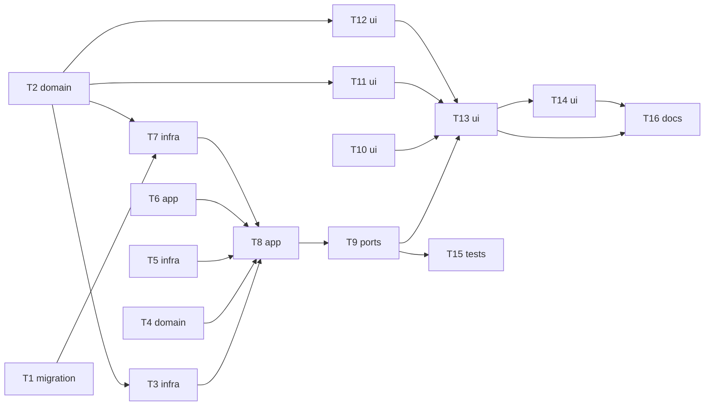

# Epic — text-to-speech

> **Spec:** [spec.md](../spec.md) · **Design:** [sad.md](../sad.md) · **Data model:** [data-model.md](../data-model.md) · **API:** [openapi.yaml](../contracts/openapi.yaml) · **Screens:** [screens.md](../screens.md) · **Tests:** [test-plan.md](../test-plan.md) · **ADRs:** [adr/](../adr/)

## Goal

Every OpenRouter speech model is usable from a rebuilt Speech page in the new Audio group, with only the controls that model accepts. Every recording is saved atomically with an honest, reconciled cost, and the prototype's recordings survive (spec §2).

## Scope

- **In:** migration 0012; shared speech spec map + DTOs; the speech port + OpenRouter adapter; file-store audio ops; cost-sync generalisation; the audio module (repo, service, routes); grouped navigation; the Speech page with recent recordings.
- **Out:** audio gallery, tags, comments (step 19); audio on the Models page (step 20); voice presets (step 21); cloning, multi-speaker, streaming; Vercel speech (spec §3).

## Task map

## Tasks

See [tracker.md](./tracker.md) for status. Machine contract: [tasks.json](../tasks.json).

| # | Task | Layer | Blocked by | DoD (short) |
|---|---|---|---|---|
| T1 | [Promote migration 0012 and keep the prototype insert valid](./promote-migration-0012.md) | migration | — | 0012 applies and reverts on a prototype-shaped DB keeping every row (amount → known, none → unavailable) and the full gate is green |
| T2 | [Add the speech family spec map and the shared speech DTOs](./speech-model-spec-and-dtos.md) | domain | — | unit tests prove family matching, control descriptors, settingsFor clamping, limit precedence, pricing unit, billedChars and the estimate |
| T3 | [Build the SpeechProvider port and the OpenRouter speech adapter](./openrouter-speech-adapter.md) | infra | T2 | adapter unit tests over recorded fixtures prove the catalog mapping for all 36 models, per-family request bodies, PCM vs mp3 request, credits, cost lookup and error mapping; the catalog caches 10 min |
| T4 | [Wrap raw PCM as a WAV file](./pcm-to-wav.md) | domain | — | unit tests prove a valid 44-byte RIFF/WAVE header for the given rate/channels, the default 24 000 Hz mono, unchanged samples, and a thrown conversion error for odd-length or empty data |
| T5 | [Give the file store single-file audio staging, trash and one combined boot sweep](./file-store-audio.md) | infra | — | file-store tests prove stage→commit, discard, trash→restore, trash→purge for audio and that one sweep restores interrupted image and audio deletions before wiping staging and drops orphan audio files; image tests unchanged and green |
| T6 | [Generalise cost sync over an injected repo and lookup](./generalise-cost-sync.md) | app | — | createCostSync takes {repo, lookupFor}; image wiring passes lookupFor from the provider registry; every existing cost-sync and image cost test passes with only constructor calls edited |
| T7 | [Write the recordings repo over the rebuilt table](./recordings-repo.md) | infra | T1, T2 | repo integration tests prove insertAtomic with a commit callback (rollback on throw), list newest first with cursor/limit, get, deleteAtomic with a file step, listPendingCosts and resolveCost honouring the status CHECK; rows zod-parsed |
| T8 | [Build the audio service: validate, speak, save atomically, track cost, delete](./audio-service.md) | app | T3, T4, T5, T6, T7 | service integration tests with a fake SpeechProvider prove every flow-1 branch (refused input, provider error/timeout, conversion/save failure → nothing left, saved with known/pending/unavailable + estimate + tracking), delete success/failure/missing, and list with modelName fallback |
| T9 | [Expose the audio contract, wire it in createApp and retire the prototype server code](./audio-routes-and-wiring.md) | ports | T8 | route integration tests prove every operation of contracts/openapi.yaml with the shared schemas (incl. 403 for a foreign origin on each), boot wiring (one sweep with both id sets, audio cost resume), and the prototype server files are gone; full gate green |
| T10 | [Group the navigation into Image and Audio and move Speech under /audio](./grouped-navigation.md) | ui | — | component tests prove two groups in order with entries, the current entry marked, the /speech alias replaced by /audio/speech, image addresses unchanged and Speech kept mounted |
| T11 | [Show speech prices, estimates and recording costs honestly](./speech-cost-display.md) | ui | T2 | unit + component tests prove every estimate wording, two significant digits, «< $0.0001», «Free», per-output and unknown wording, and the cost label for known/pending/unavailable with and without an estimate |
| T12 | [Build ModelSelect, VoiceSelect and descriptor-driven VoiceControls](./speech-model-and-voice-controls.md) | ui | T2 | component tests prove grouping by maker with price/limit, voice filtering above 20, provider default + typed voice for voice-less models, only the model's controls rendered from descriptors, steps labels, Reset to the model's defaults leaving voice and text |
| T13 | [Rebuild the Speech page on the new contract](./speech-page-rebuild.md) | ui | T9, T10, T11, T12 | component tests prove compose/validation/working/provider-error/save-error/not-configured/models-error states, one request per click, state kept across navigation, result autoplay + download, credits refresh; prototype shared/audio.ts and old api methods deleted; full gate green |
| T14 | [List recent recordings with reuse, delete and live pending costs](./recent-recordings.md) | ui | T13 | component tests prove the ten latest with all fields, loading/empty/error, 10 s refresh only while a cost is pending, reuse filling the form, the replace confirm, the model-gone notice, delete confirm/busy/failure and removal |
| T15 | [Prove the audio NFRs and the image/audio separation](./audio-nfr-and-cross-context.md) | tests | T9 | timing tests meet the §6 thresholds and cross-context tests prove recordings stay out of every image list and the key never appears in answers, rows or settings |
| T16 | [Register the audio components in the design canon and the architecture map](./register-audio-components.md) | docs | T13, T14 | design-system.md lists Tabs, Slider, Label and the new audio components with their states; architecture-map.md describes the rebuilt audio module, the speech port and the grouped sections |

## Risks / Hard rules

- `migrations/0011_*` stays byte-for-byte; never run migrations, the server or scripts against `./data` (owner rule, sad §2).
- Image behaviour unchanged: existing tests stay green unchanged except constructor calls in `cost-sync.test.ts` (ADR-0043).
- The server binds 127.0.0.1 only; the OpenRouter key never reaches the browser, a row or a log (CLAUDE.md hard rules, spec AC-19).
- Every commit green (`pnpm typecheck && pnpm lint && pnpm test`): new server code lands beside the prototype under new names (T3, T7) and replaces it in T9; the old web page and `src/shared/audio.ts` go in T13.
