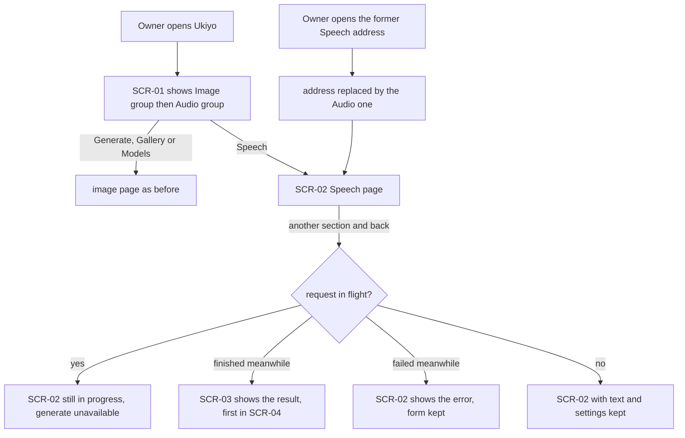
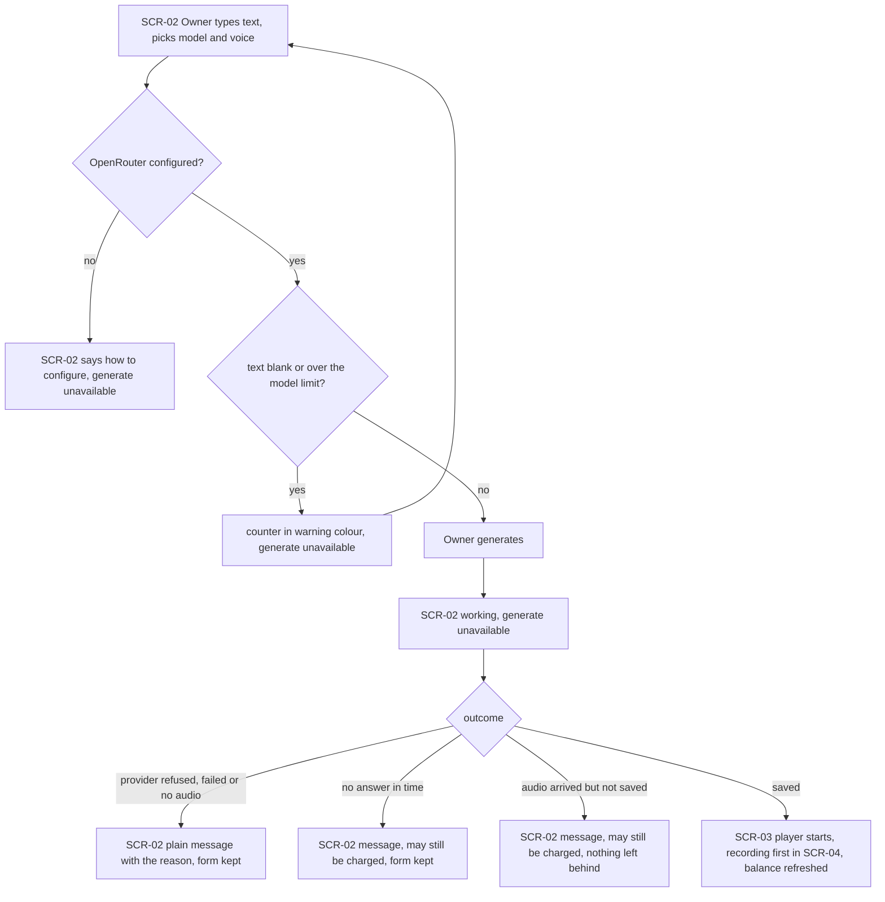
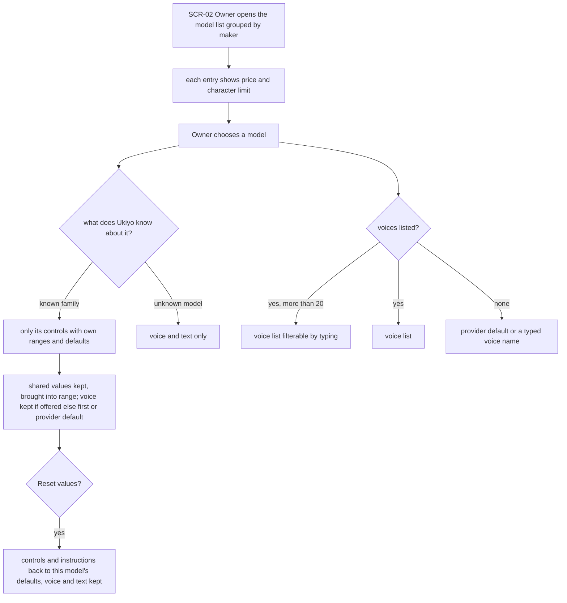
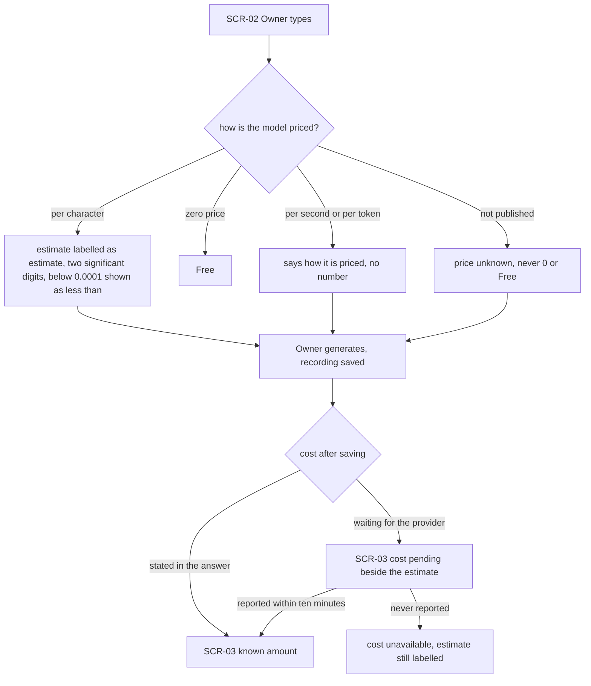
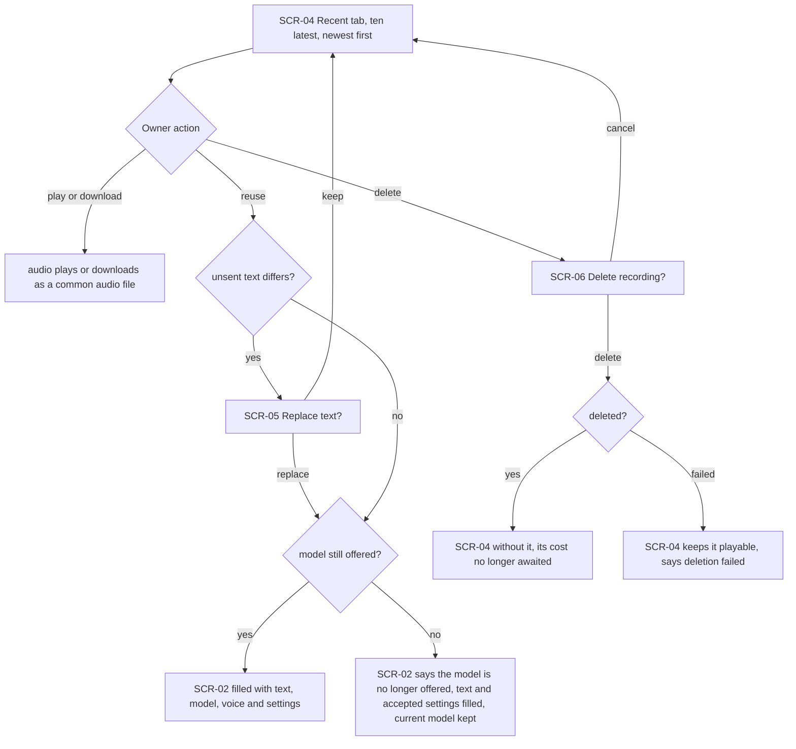
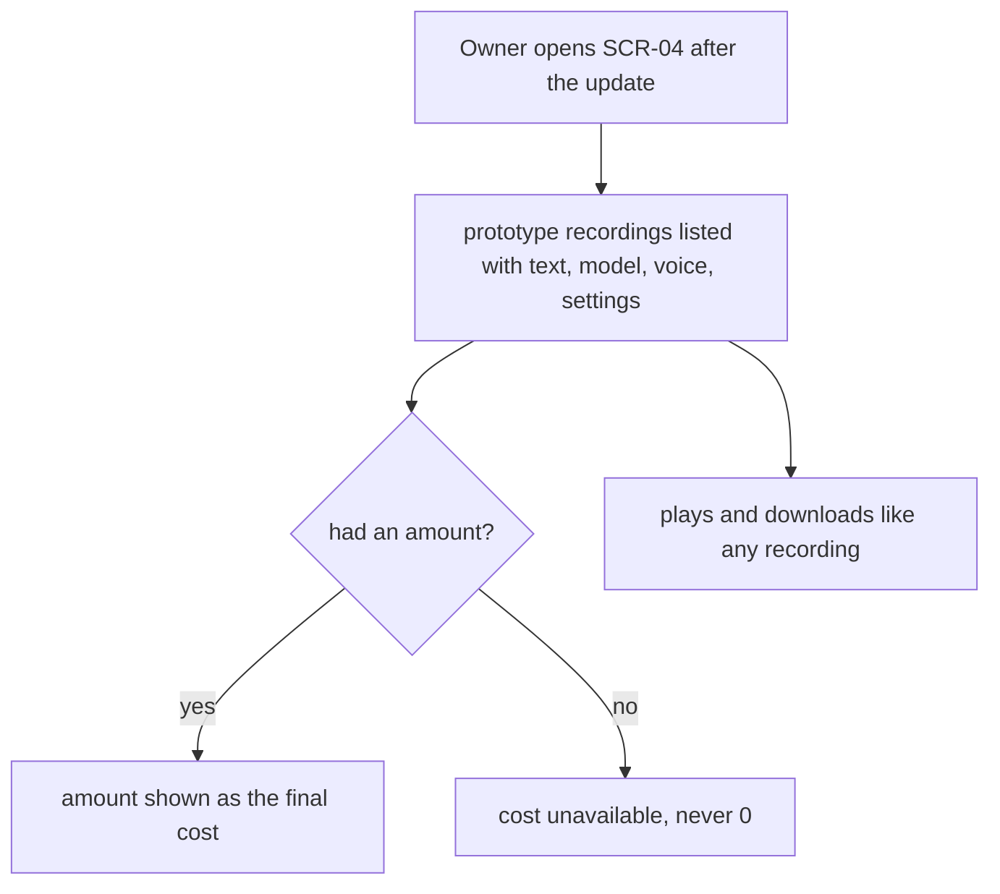

# UX flows — text-to-speech

## Platform decisions

- **Posture:** desktop-first, per [`design-system.md`](../../design-system.md): designed at `lg` (≥ 1024 px), with the side panel next to the text. Below `lg` the side panel opens as a sheet, as the prototype does. Phone layout is not a goal.
- **Tool:** code mode — flows here, inline wireframes in `screens.md`.

## Screen inventory

| SCR | Screen | Purpose | Entry | Exit |
|---|---|---|---|---|
| SCR-01 | Navigation bar (grouped) | Image group (Generate, Gallery, Models), then the Audio group (Speech) | always visible | any section |
| SCR-02 | Speech page — compose | text, character counter, estimate, credit balance, generate; side panel «Settings» with voice, model and the model's controls | Audio → Speech; the former Speech address | generate → SCR-03; «Recent» tab → SCR-04 |
| SCR-03 | Speech page — latest result | player (autoplays when it is new), voice, model, time, cost with its status (+ «≈ estimate»), download | after a generation; choosing a recording | back to composing on the same page |
| SCR-04 | Speech page — recent recordings | the ten latest recordings: player, excerpt, voice, model, time, cost, download, reuse, delete | side panel «Recent» tab | reuse → SCR-02 (filled) / SCR-05; delete → SCR-06 |
| SCR-05 | Replace text? (confirm) | ask before overwriting unsent text that differs from the recording's | reuse with different unsent text | replace → SCR-02 filled; keep → SCR-04 |
| SCR-06 | Delete recording? (confirm) | deletion has no undo | delete on a recording | delete → SCR-04 without it; cancel → SCR-04 |

## Flows

### US-01: Find Image and Audio apart

### US-02: Turn text into speech

### US-03: Use each model's own controls

### US-04: Know what a recording costs

### US-05: Keep and manage my recordings

### US-06: Keep my prototype recordings

## AC coverage

| AC | Flow / node |
|---|---|
| AC-01 | US-01: SCR-01 groups; former address replaced |
| AC-02 | US-01: «another section and back» branches |
| AC-03 | US-02: saved → SCR-03 |
| AC-04 | US-02: blank or over the limit |
| AC-05 | US-02: refused / no answer in time |
| AC-06 | US-02: not configured |
| AC-07 | US-03: list with price and limit, known family, voice filtering |
| AC-08 | US-03: shared values kept, voice fallback, Reset |
| AC-09 | US-03: unknown model, no voices |
| AC-10 | US-05: play or download a common audio file |
| AC-11, AC-12 | US-04: pricing branches |
| AC-13 | US-04: cost after saving |
| AC-14 | US-02: balance refreshed; N/A for the rest — recordings never appear on image screens (no image screen changes) |
| AC-15 | US-05: reuse, replace confirm, model no longer offered |
| AC-16 | US-05: delete branches |
| AC-17 | US-02: working, generate unavailable; US-01: in flight after navigating |
| AC-18 | US-06 |
| AC-19 | N/A — not a UI path (a foreign site's request is refused by the server) |
| AC-20 | US-02: audio arrived but not saved |

Out of scope (no UI): none. Every user story touches the Speech page.
