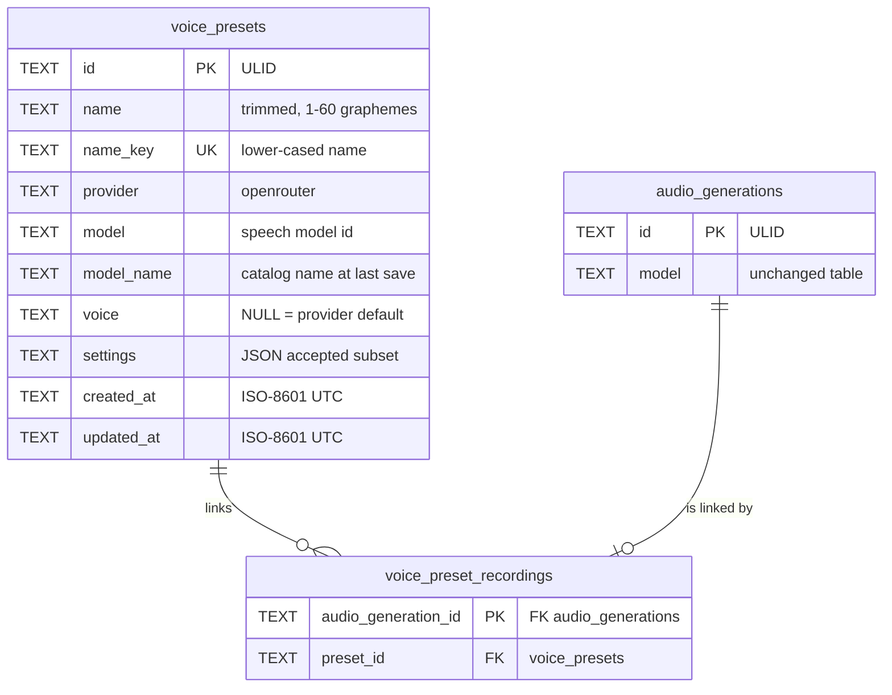

# Data model — voice-presets

> Sources: spec §5 (AC-01, AC-02, AC-04, AC-07, AC-08, AC-11…AC-13, AC-16, AC-18) + §6, sad.md §4 items 1–5 / §6, ADR-0057, ADR-0058.
> Conventions followed (from `migrations/0012`, `0013`): snake_case, ULID text PKs, `CHECK` constraints, JSON settings as text, ISO-8601 UTC text, cascading child tables, `IF NOT EXISTS`, paired up/down files.

## Aggregates

| Aggregate root | Owns | Module |
|---|---|---|
| Voice preset (`voice_presets`, **new**) | name, speech model, voice, settings | `src/server/modules/audio/` (presets repo) |
| Recording (`audio_generations`, unchanged) | its text, setup, file, cost, tags, comment — and its link row | `src/server/modules/audio/` |

`voice_preset_recordings` (**new**) is a link owned by the recording (one row per linked recording, PK = the recording id); it cascades from both sides (ADR-0057). Preset stats (count, known total, pending / unavailable counts, last use) are **computed on read**, never stored (sad §4 item 4).

## ER

## Fields and constraints

| Column | Type | Constraint | Why |
|---|---|---|---|
| voice_presets.id | TEXT | PK | ULID from `newId()` |
| name | TEXT | `length BETWEEN 1 AND 240`, `name = trim(name)` | AC-02: the 1–60 grapheme rule lives in the shared `presetName` schema (SQLite counts code points); 240 is a safety cap |
| name_key | TEXT | NOT NULL UNIQUE | AC-02 uniqueness ignoring case in any alphabet — JS `toLowerCase()` (SQLite `lower()` folds ASCII only) |
| provider | TEXT | length 1–32 | as `audio_generations.provider` |
| model | TEXT | length 1–100 | as `audio_generations.model` |
| model_name | TEXT | length 1–200 | display when the model is retired (AC-09, ADR-0052 precedent) |
| voice | TEXT | NULL or length 1–100 | NULL = provider default voice, as recordings |
| settings | TEXT | NOT NULL | JSON, always `settingsFor(model.controls, …)` at save/update; parsed with `VoiceSettings.catch({})` on read |
| created_at, updated_at | TEXT | NOT NULL | ISO-8601 UTC |
| voice_preset_recordings.audio_generation_id | TEXT | PK, FK → `audio_generations(id)` ON DELETE CASCADE | at most one preset per recording; a deleted recording drops its link (AC-16) |
| preset_id | TEXT | NOT NULL, FK → `voice_presets(id)` ON DELETE CASCADE | a deleted preset drops its links, recordings stay (AC-07, AC-08) |

## Access patterns

| Query | Statement | Index |
|---|---|---|
| list presets with stats, by name (AC-11, AC-12) | `SELECT p.*, count(a.id), sum(CASE WHEN a.cost_status='known' THEN a.cost_micros END), sum(a.cost_status='pending'), sum(a.cost_status='unavailable'), max(a.created_at) FROM voice_presets p LEFT JOIN voice_preset_recordings l ON l.preset_id = p.id LEFT JOIN audio_generations a ON a.id = l.audio_generation_id GROUP BY p.id ORDER BY p.name_key` | `name_key` UNIQUE (order), `voice_preset_recordings_by_preset` (join), `audio_generations` PK |
| one preset with stats | same `WHERE p.id = ?` | PK + link index |
| a preset's recordings, newest first, cursor (AC-13) | `SELECT a.* FROM voice_preset_recordings l JOIN audio_generations a ON a.id = l.audio_generation_id WHERE l.preset_id = ? [AND l.audio_generation_id < ?] ORDER BY l.audio_generation_id DESC LIMIT ?` | `voice_preset_recordings_by_preset` |
| presets of a page of recordings (Recording.preset) | `SELECT l.audio_generation_id, p.id, p.name FROM voice_preset_recordings l JOIN voice_presets p ON p.id = l.preset_id WHERE l.audio_generation_id IN (…)` | link PK |
| link on save (ADR-0058) | `INSERT INTO voice_preset_recordings SELECT ?, ? WHERE EXISTS (SELECT 1 FROM voice_presets WHERE id = ?)` inside the recording's insert transaction | PK |
| name clash | the UNIQUE violation on `name_key` → `VALIDATION_ERROR` `fields.name` | `name_key` UNIQUE |
| delete a preset | `DELETE FROM voice_presets WHERE id = ?` (links cascade) | PK + link index (FK) |

## Migrations

Staged here, promoted by `implement` as `migrations/0016_create_voice_presets.{up,down}.sql`:

- `migrations/01_create_voice_presets.up.sql` — two `CREATE TABLE IF NOT EXISTS` + one index (additive; touches no existing row).
- `migrations/01_create_voice_presets.down.sql` — drops the index and both new tables (recordings, tags and comments untouched).

## Test fixtures

No seeds. Tests create presets through the presets repo / `POST /api/audio/presets` and recordings through the existing fake speech fetch (`tests/fixtures/openrouter/`).

## Audit

See [`_audit/data-model-2026-10-25.md`](./_audit/data-model-2026-10-25.md).
