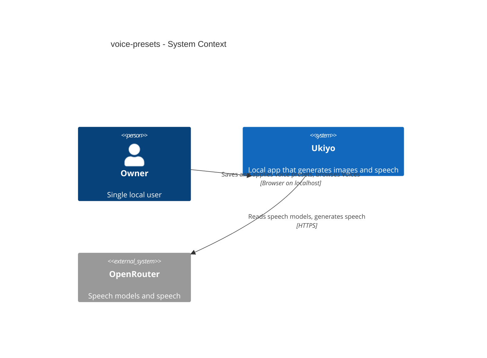
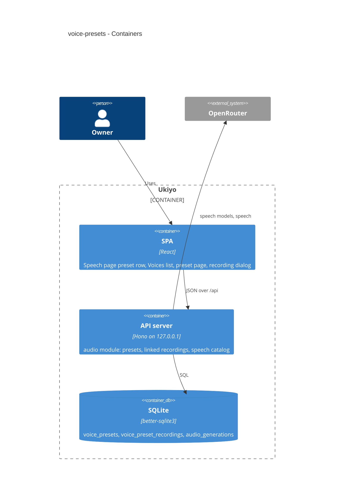
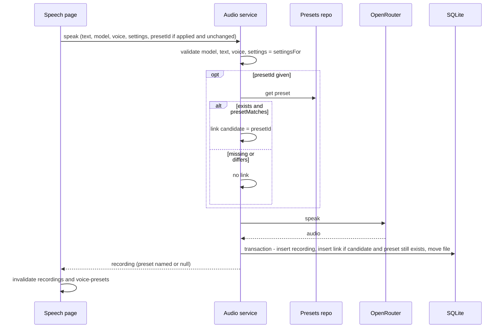
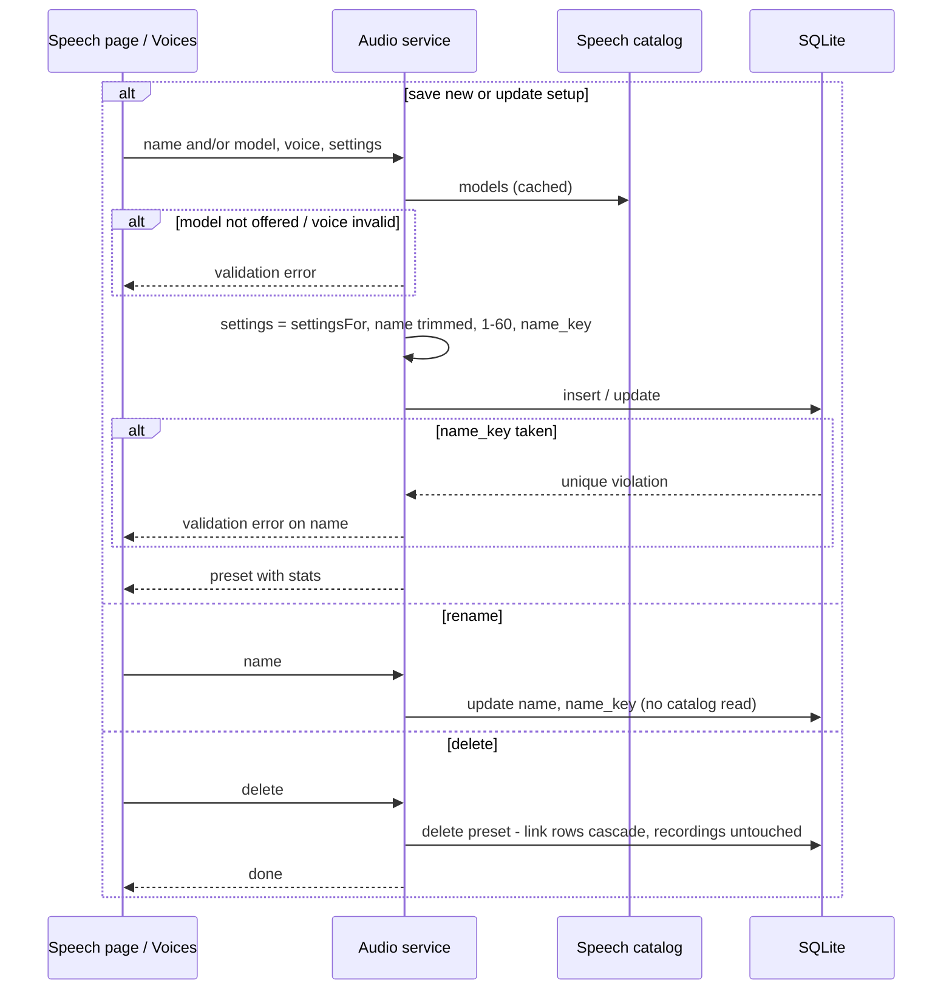
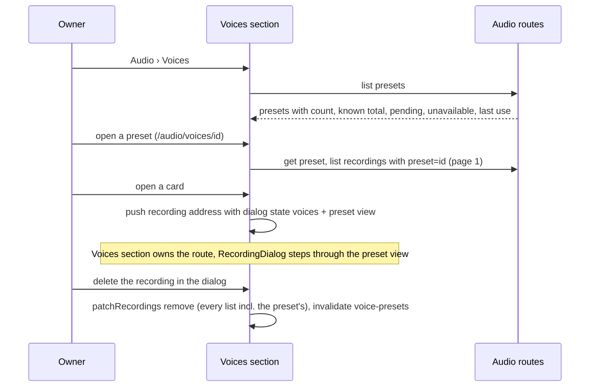
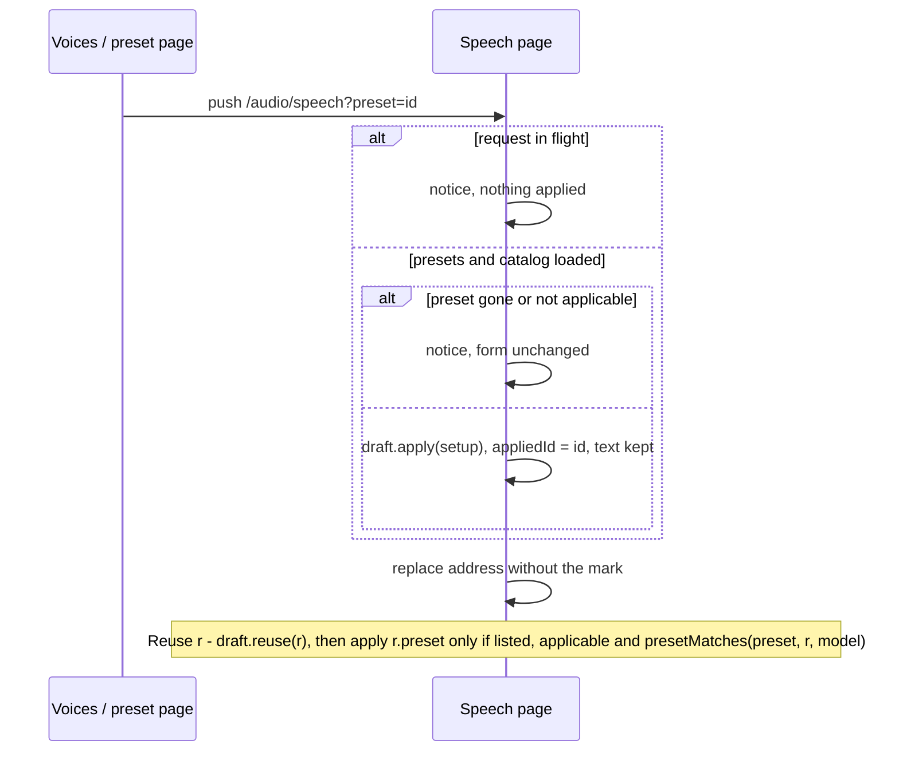

# Software Architecture Document — voice-presets

## 1. Introduction and goals

**Intent.** The Owner saves a speaker setup (speech model, voice, voice settings — never the text) as a named voice preset, applies it on the Speech page in one click, and every recording made with an applied, unchanged preset is linked to it; a new Audio section «Voices» lists the presets with their use and cost and opens each preset's recordings in the audio gallery's grid and dialog (spec §1 ¶3, §2).

**Top-3 quality goals (1-liners; full scenarios in §10):**
1. **Truthful link** — a recording is linked only when the server finds that what it is about to send equals the preset's stored setup; a link can't be claimed by the page (AC-05, AC-18, §6.1).
2. **Recordings are never at risk** — presets are purely additive: deleting or changing a preset never deletes, rewrites or fails to save a recording, and the migration touches no existing row (AC-08, AC-18, NFR migration safety).
3. **Honest, current numbers** — a preset's count, total and last use are computed from the recordings that exist, known costs only with the missing ones named (AC-12, AC-16), ≤ 100 ms for 200 presets and 5 000 recordings (spec §6).

**Stakeholders.**

| Role | Interest | Sign-off owner? |
|---|---|---|
| Owner (also Tech Lead for SAD approval) | saves and reuses speakers, compares their use and cost | Yes |

## 2. Constraints

**Technical.** Same stack (CLAUDE.md). Recordings: `audio_generations` (0012) with tags and comments cascading from it (0013) — it must **not** be rebuilt (a rebuild would cascade-delete them); the owner's running `pnpm dev` applies a new file in `migrations/` at its next restart, so the 0016 pair is promoted finished, `.down.sql` first, and never edited after. Sections are registry entries (ADR-0022) with groups (ADR-0046), `owns` and `detail` (ADR-0048), query-carrying paths (ADR-0056). The audio gallery's dialog engine (`MediaDialog`, ADR-0049), its by-shape cache patching (`patchRecordings`) and the Speech page's address-carried handover (`?reuse=`, ADR-0053) exist. `useSpeechDraft` pins its automatic pick once (models-page-audio §4 item 5); stored settings are always the model's accepted subset (`settingsFor`, ADR-0040).
**Organisational.** Solo maintainer; local gate only; one PR (#8) for the audio epic — this is its last step.
**Conventions.** CLAUDE.md: shared zod schemas in `src/shared/`; `AppError` with the closed code union (no new code — a name clash is a `VALIDATION_ERROR` on `name`); hand-written SQL in a repo with every row zod-parsed; shadcn/ui primitives only.
**Regulatory / external.** None — no provider call is added; a preset never reaches the provider.

## 3. Context and scope

The browser reads and changes presets on the local server and sends a preset id with a speech request; the server keeps presets and links in SQLite and calls OpenRouter only for the speech it already calls for.

**External systems (in / out):**

| Actor or system | Type | Interaction |
|---|---|---|
| Owner | Person | saves, applies, renames, deletes presets; browses Voices and a preset's recordings |
| OpenRouter | System (external) | speech model list (cached, existing) to validate a preset's setup; speech generation (existing) |

**C4 Context (L1):**

## 4. Solution strategy

**Target surface:** `[web-frontend, backend-service]` — the existing SPA and API server (ux-flows SCR-01…SCR-07); UI architecture unchanged (SPA, History-API router, TanStack Query — ADR-0009, ADR-0022).

1. **Links in their own table, not a column on recordings** — `voice_presets` plus `voice_preset_recordings (audio_generation_id PK → audio_generations ON DELETE CASCADE, preset_id → voice_presets ON DELETE CASCADE)`, index `(preset_id, audio_generation_id)`; deleting a preset drops its link rows (the recordings stay, unlinked), deleting a recording drops its link row; rollback = drop both tables; `audio_generations` is not touched → [ADR-0057](./adr/0057-link-recordings-to-voice-presets-through-a-separate-link-table.md).
2. **The server decides the link** — the speech request carries an optional `presetId`; after the usual validation the service reads the preset and compares it with what it is about to send using one shared pure function `presetMatches(preset, setup, model)` (`src/shared/voice-presets.ts`: same model id, same voice — `null` only equals `null` — and `settingsFor(model.controls, setup.settings)` deep-equal to the stored settings, key order ignored; `model` is the current catalog entry). A match is remembered; the link row is inserted inside the recording's save transaction only if the preset still exists then (`INSERT … SELECT … WHERE EXISTS`). No match, an unknown or a deleted preset → saved unlinked, never refused (the request is paid). The Speech page uses the same function for «modified» → [ADR-0058](./adr/0058-decide-a-recordings-preset-link-on-the-server-by-comparing-the-normalized-setup.md).
3. **Presets inside the audio module** (inline) — `modules/audio/presets-repo.ts` + preset operations in `service.ts` + routes in `routes.ts`; no new module (presets are meaningless without recordings and the speech catalog). A preset stores `model_name` at save/update time (display when the model is retired, ADR-0052 precedent). Names: trimmed, 1–60 characters as the Owner sees them (graphemes, `Intl.Segmenter`, in the shared `presetName`; the table only caps `length(name) <= 240` as a safety net), `name_key = name.toLowerCase()` (JS, Unicode-aware — SQLite's `lower()` folds ASCII only) with a UNIQUE constraint; a clash → `VALIDATION_ERROR` `fields.name`. Creating and updating the setup validate it against the speech catalog like a speech request (model offered, voice per `checkVoice`, settings stored as `settingsFor`), reading the last catalog answer through `peek()` even past its TTL and fetching only when there is none (ADR-0052 precedent), so a preset change never waits on the provider when Speech has loaded models; a rename never reads the catalog.
4. **Stats computed on read, never stored** (inline) — the list query aggregates `count`, `sum(cost_micros) WHERE known`, the pending and unavailable counts and `max(audio_generation_id)` (→ its `created_at`) per preset from the link join, in one statement; no counters to drift (AC-16). Ordered by `name_key`.
5. **A preset's recordings are another audio list view** (inline) — `AudioListView` gains `{ kind: "preset"; presetId }` (key `[...RECORDINGS_KEY, "list", "preset", id]`), read through `GET /audio/recordings?preset=<id>` (newest first, cursor by id, via the link index); being under `RECORDINGS_KEY`, `patchRecordings` and the invalidations of steps 18–19 keep it current for free. `Recording` gains `preset: { id, name } | null` (one extra query per page, like `curationOf`).
6. **The recording dialog belongs to the grid that opened it** — `DIALOG_OF` lists both galleries for the `recording` route; a card on a preset page pushes `mediaDialogState("voices", { grid: presetView, order: presetView })`; the Voices section `owns` a recording route only when `isDialogVisit(route)` and its state names `voices` (a reload — new load id — falls back to the audio gallery's recording page), and has `detail: { route: "recording", label: "Recording", Page: RecordingPage, Dialog: RecordingDialog }`; the audio gallery owns every other recording route; `VoicesPage` on a recording route takes the preset from `state.grid`; `RecordingDialog` takes the gallery id from the state, so ← →, close-to-place and deletion stepping work unchanged; `useAudioGalleryView` takes a dialog's grid as its last view only when the state names `audio-gallery` → [ADR-0059](./adr/0059-let-the-grid-that-opened-a-recording-dialog-own-it-by-its-history-state.md).
7. **Preset pages owned by the Voices section; aliases only when declared** — section `voices` (group audio, path `/audio/voices`, label «Voices», after Gallery and before Models) `owns` page routes under `/audio/voices/<id>`; `App`'s alias redirect fires only when the pathname with one trailing slash trimmed is listed in the section's `aliases` (today it fires for any pathname differing from the section's path, which would bounce `/audio/voices/<id>` to `/audio/voices`) → [ADR-0060](./adr/0060-redirect-only-declared-section-aliases-so-sections-can-own-sub-paths.md).
8. **Applied preset is Speech page state; apply = a reuse without text** (inline) — `useSpeechDraft` gains `apply(setup)` that sets model, voice and raw settings exactly as `reuse` does (overriding the pinned automatic pick; a hidden model is allowed; the full catalog is used for lookups) but keeps the text. `SpeechPage` keeps `appliedId`; the applied preset is looked up in the presets query each render, so a rename or update elsewhere shows at once and a deleted one detaches (AC-07). «modified» = `!presetMatches(applied, current)`. Generate sends `presetId` only while applied and unchanged. «No longer offered» = model absent from the loaded catalog, or a stored voice (not `null`) that a model with a voice list no longer lists, whatever its `voiceMode`; while the catalog isn't loaded, presets are listed but not applicable (AC-09).
9. **Apply from Voices = `?preset=<id>` on the Speech address** (inline, ADR-0053 precedent) — pushed (Back returns to Voices / the preset page), applied once on arrival when the presets and the catalog are known, refused with step 19's notice while a request is in flight; the mark is dropped with `replace`.
10. **Reuse of a linked recording re-applies its preset only if it still matches** (inline) — after `draft.reuse(r)`, if `r.preset` names a preset in the list that is applicable and `presetMatches(preset, r)`, it becomes applied (AC-15).
11. **Cache keys and refresh** (inline) — presets under `["voice-presets"]` (list) and `["voice-presets", id]` (one); a recording created (SpeechPage `onSuccess`) or deleted (`patchRecordings` remove, which gains this invalidation) invalidates `["voice-presets"]`; a preset rename/update/delete updates the list from the answer and invalidates `RECORDINGS_KEY` and `["recording"]` entries so the named preset follows (AC-07). Voices reads with `refetchOnMount: "always"` so a cost settled meanwhile shows on the next visit (AC-12).

## 5. Building block view

**C4 Container (L2):**

| Block | Responsibility | Change |
|---|---|---|
| `migrations/0016_create_voice_presets` | `voice_presets`, `voice_preset_recordings`, link index | new |
| `shared/voice-presets.ts` | zod: `VoicePreset`, `VoicePresetsResponse`, `SavePresetRequest`, `UpdatePresetRequest`; `presetName` rules; `presetMatches` | new |
| `shared/speech.ts` | `StartSpeechRequest.presetId`, `Recording.preset` | changed |
| `modules/audio/presets-repo.ts` | preset CRUD, stats aggregate, link insert, preset-of-recordings | new |
| `modules/audio/repo.ts` | list by preset; insert transaction also inserts the link | changed |
| `modules/audio/service.ts`, `routes.ts` | preset operations; link decision in `start`; `?preset=` filter | changed |
| `server/app.ts` | presets repo wired into the audio service | changed |
| `web/lib/api.ts` | preset calls, `recordings(…, { preset })` | changed |
| `web/lib/router.tsx` | `DIALOG_OF` per route kind → list of galleries | changed |
| `web/App.tsx` | alias redirect only for declared aliases | changed |
| `web/sections.tsx` | `voices` section with `owns` (preset pages, its dialog visits) and `detail`; `audio-gallery.owns` excludes Voices dialog visits | changed |
| `web/features/audio/presets/` | `PresetRow` (Speech), `SavePresetDialog`, `RenamePresetDialog`, `DeletePreset`, `VoicesPage` (list + preset page), `PresetCard`, `presetCost`, queries | new |
| `web/features/audio/useSpeechDraft.ts`, `SpeechPage.tsx` | `apply`, applied preset, `?preset=`, `presetId` on generate, reuse re-apply | changed |
| `web/features/audio/gallery/` (`audioGalleryView`, `useAudioGalleryView`, `queries`, `patchRecordings`, `RecordingDialog`, `RecordingDetail`, `RecordingCard`) | preset view kind; dialog gallery from state; detail names the preset | changed |

## 6. Runtime view

### 6.1 Generate with an applied preset (AC-04, AC-05, AC-18)

### 6.2 Save, update, rename, delete a preset (AC-01, AC-02, AC-06, AC-07)

### 6.3 Voices and a preset's recordings (AC-11, AC-13, AC-16)

### 6.4 Apply from Voices (AC-14) and reuse of a linked recording (AC-15)

## 7. Deployment view

Unchanged: one Node process on `127.0.0.1`; migration 0016 applies on boot (and by the Owner's running `pnpm dev` when the file lands — hence promoted finished, additive only).

## 8. Crosscutting concepts

- **Wording:** «No voice preset», «<name>», «<name> · modified»; «Save», «Update «<name>»», «Save as new», «Detach», «Rename», «Delete»; name suggestion `«${voiceLabel(voice)} · ${model.name}»` cut to 60; count «1 recording» / «N recordings» / «No recordings yet»; total per AC-12 (`formatUsdSig` of known micros, «+ N pending», «· N without a price», «—»); last use `formatRelative` of the newest linked recording, «Never used»; settings badges from `settingsLabels`; voice from `voiceLabel`.
- **Errors:** name rules on both sides from one shared schema (`presetName`); server messages «Enter a name», «At most 60 characters», «A voice named «X» already exists»; not found → `NOT_FOUND`; a preset reference in a speech request never produces an error.
- **Security:** same-origin guard covers every new route (ADR-0007); names rendered as text by React.
- **Concurrency:** single process, synchronous better-sqlite3 — the link insert and the preset delete can't interleave inside a transaction; the `EXISTS` guard covers a delete between the comparison and the save.

## 9. Architecture decisions

- [ADR-0057](./adr/0057-link-recordings-to-voice-presets-through-a-separate-link-table.md) — links in a separate cascading table; `audio_generations` untouched.
- [ADR-0058](./adr/0058-decide-a-recordings-preset-link-on-the-server-by-comparing-the-normalized-setup.md) — the server decides the link with the shared `presetMatches`; never refuses a paid request.
- [ADR-0059](./adr/0059-let-the-grid-that-opened-a-recording-dialog-own-it-by-its-history-state.md) — the recording dialog belongs to the gallery named in its history state.
- [ADR-0060](./adr/0060-redirect-only-declared-section-aliases-so-sections-can-own-sub-paths.md) — alias redirects only for declared aliases; Voices owns `/audio/voices/<id>`.

## 10. Quality requirements

| Scenario | Stimulus | Response | Measure |
|---|---|---|---|
| Truthful link | request names a preset whose stored settings differ / that doesn't exist / that is deleted while the provider answers | recording saved, unlinked; matching one saved linked | integration tests |
| Recordings safe | delete a preset with recordings | recordings, tags, comments and files unchanged; no preset named | integration test |
| Voices list | 200 presets, 5 000 recordings | «the list with every preset's count, total and last use ≤ 100 ms p95 server time … without any provider call» | `nfr` timing test |
| Preset page grid | 5 000 recordings | «one page of a preset's recordings ≤ 100 ms p95 server time» | `nfr` timing test |
| Preset changes | save / update / rename / delete | «save, update, rename, delete each ≤ 50 ms p95 server time, never waiting on the provider» (also with a stale catalog entry) | `nfr` timing test |
| Apply | pick a preset | «applying a preset updates the Speech form within one frame of the pick, with no request to the server beyond the already loaded preset list» | component test counting requests |
| Link check | generate linked | «checking a recording's link adds no provider call and no visible delay to generating» | integration test with fake fetch counting calls |
| Migration | DB at 0015 with recordings, tags, comments | 0016 applies; existing rows unchanged and unlinked; rollback drops only the new tables | migration test + ship check on a copy of the Owner's data |
| Foreign page | any preset route / linked generation from another origin | refused, nothing changes | integration test |

## 11. Risks and technical debt

- **Catalog drift vs stored settings:** a family-spec change (ADR-0040) can make every preset of a model «modified» on apply (AC-10). Accepted — the Owner updates it; Ukiyo never rewrites a preset by itself.
- **Name case folding:** JS `toLowerCase()` folds Unicode letters but not every compatibility form (e.g. full-width letters); accepted for one Owner.
- **Stats on every list read** grow with recordings; the NFR test at 5 000 recordings guards it; counters would be the fallback.
- **Alias rule change (ADR-0060)** touches every section; the existing alias test (`/speech`) plus a new `/speech/` test pin it.

## 12. Glossary

See [CONTEXT](../../../CONTEXT.md): Voice preset, Voice, Voice settings, Recording, Reuse (recording), Hidden model, Cost status, Section.
