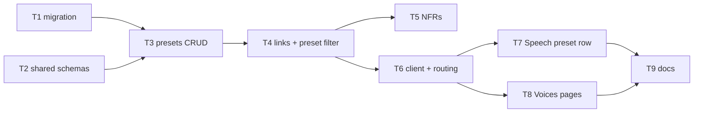

# Epic — voice-presets

Roadmap step 21: named voice presets on the Speech page, truthful links from recordings, a Voices section with each preset's recordings. Spec [spec.md](../spec.md) · SAD [sad.md](../sad.md) · ADR-0057…0060.

