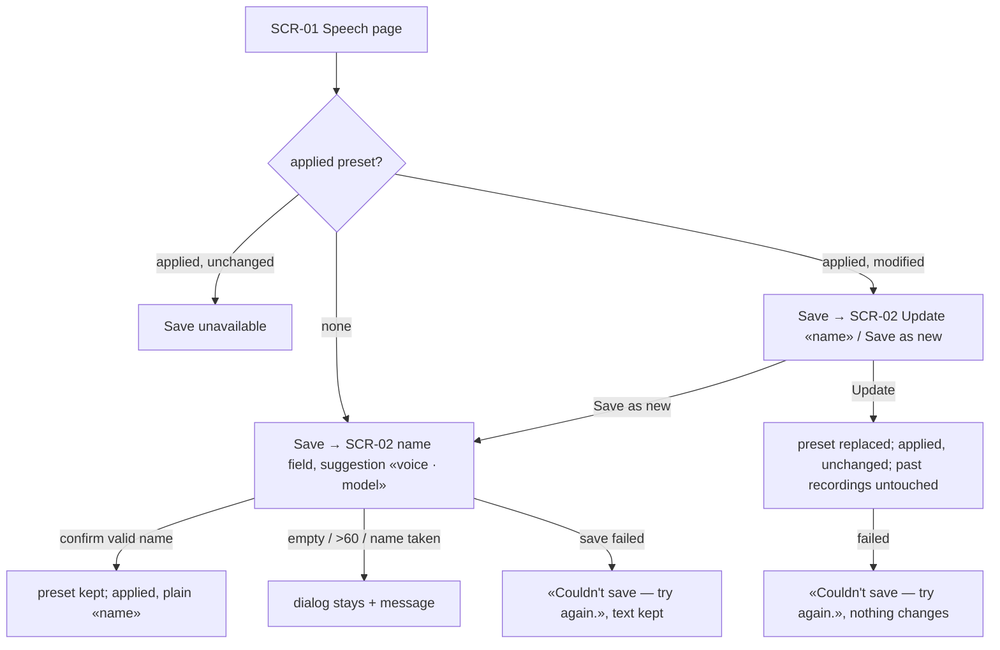
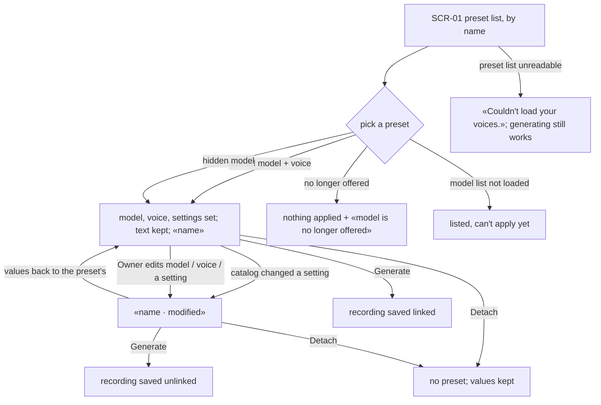
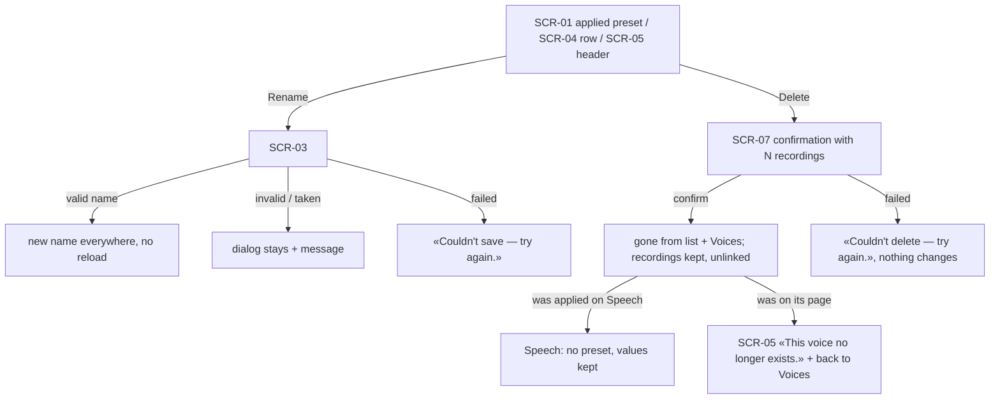
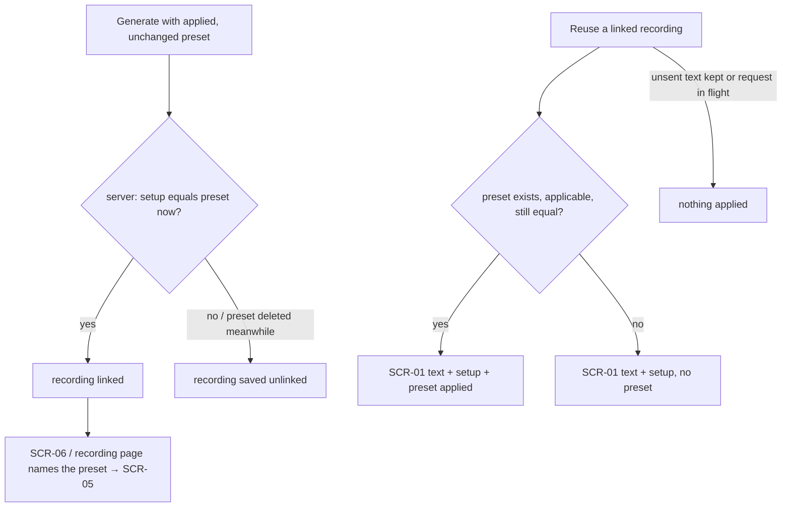
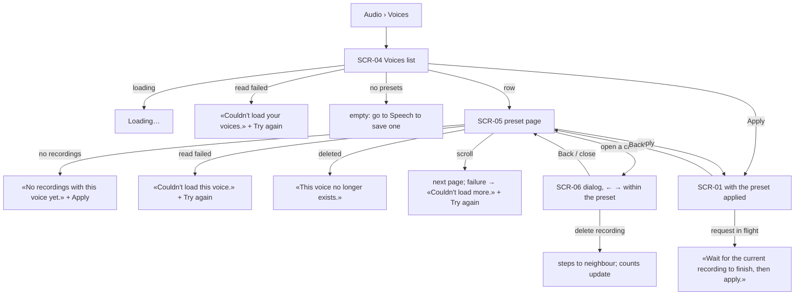

# UX flows — voice-presets

Platform: desktop-first responsive web (the design-system posture, unchanged). The Speech page's side panel
(and its sheet below `lg`) gains a preset row above Voice; Voices is a new Audio section.

## Screen inventory

| SCR | Screen | Notes |
|---|---|---|
| SCR-01 | Speech page — preset row | the applied preset («<name>», «<name> · modified» or «No voice preset»), the preset list, Save, Detach, Rename, Delete |
| SCR-02 | Save dialog | name a new preset, or choose «Update «<name>»» / «Save as new» for a modified one |
| SCR-03 | Rename dialog | same naming rules as SCR-02; opened from SCR-01, SCR-04 or SCR-05 |
| SCR-04 | Voices list | `/audio/voices` — every preset with model, voice, settings, count, total, last use |
| SCR-05 | Preset page | `/audio/voices/<id>` — the preset's header and the grid of its recordings |
| SCR-06 | Recording dialog over the preset grid | the audio gallery's dialog, stepping only through the preset's recordings |
| SCR-07 | Delete confirmation | «Delete «<name>»? Its N recordings are kept.» |

## US-01 / US-03 — save, update, save as new

## US-02 — apply, modify, detach

## US-03 — rename and delete

## US-04 — the link, seen from a recording

## US-05 / US-06 — Voices and a preset's page

## AC → flow map

| AC | Flow |
|---|---|
| AC-01, AC-02, AC-06 | US-01 / US-03 save |
| AC-03, AC-05, AC-09, AC-10 | US-02 apply |
| AC-07, AC-08 | US-03 rename / delete |
| AC-04, AC-15, AC-18 | US-04 link |
| AC-11, AC-12, AC-13, AC-14, AC-16, AC-19 | US-05 / US-06 |
| AC-17 | N/A: no screen — a refused foreign request shows nothing |
