# Roadmap — Ukiyo

> **A decomposition, not a promise.** The overall idea broken into incremental steps: what each
> step is, where it comes from, how big it is — or that nobody has looked at it yet — and in which
> order, and parallel lanes, we walk them. **No dates** (except shipped history), **no scores** —
> order is the prioritization. The *solution* for any step lives in its `docs/features/<slug>/`
> spec, not here.

## Destination

The single owner, on one machine, generates images from text and/or input images through both OpenRouter and Vercel AI Gateway, and every result lives in a local gallery with enough metadata to re-run it, switch its model, or feed it into the next generation, organised by folder, model and prompt in a paged grid, with a curated model catalog one click away — and, in a separate Audio section, turns text into speech with any OpenRouter speech model, keeping every recording in its own gallery with reusable voice presets.

## Steps

| # | Step | Source | Size | Status |
|---|---|---|:---:|---|
| 1 | Project skeleton — modules, test harness, SQLite + migration runner, conventions doc (`/sdd:scaffold`) | architecture-map.md §Module inventory | S | idea |
| 2 | Text→image via OpenRouter, saved locally and browsable — generate form, `ImageProvider` port + OpenRouter adapter, image files + full metadata (prompt, model, params, cost with status, created at, duration, raw request/response), gallery + detail view | idea-brief.md §7 Recommendation | M | shipped → [`features/text-to-image-openrouter`](./features/text-to-image-openrouter/spec.md) |
| 3 | Image inputs via OpenRouter — img→img and img+text→img: attach input images, store their copies, show them on the generation's detail view | idea-brief.md §2 Problem | S | shipped → [`features/image-inputs-openrouter`](./features/image-inputs-openrouter/spec.md) |
| 4 | Vercel AI Gateway — image-only models (`/v1/images/generations`, `/v1/images/edits`) and multimodal LLMs (chat `modalities`), with async cost lookup (`pending → known / unavailable`) | idea-brief.md §6 Risks | M | shipped → [`features/vercel-ai-gateway`](./features/vercel-ai-gateway/spec.md) |
| 5 | Curate the gallery — add a comment, tag, delete a generation | idea-brief.md §7 Recommendation | M | shipped → [`features/curate-gallery`](./features/curate-gallery/spec.md) |
| 6 | Re-run & reuse — re-run with the same inputs (same or another model) via a pre-filled form, and use an output as the next input in one click with parent→child lineage | idea-brief.md §7 Recommendation | M | shipped → [`features/rerun-and-reuse`](./features/rerun-and-reuse/spec.md) |
| 7 | Model price preview — show each model's price in the model picker and a pre-run estimate («≈ $0.04 for 2 images»); exact for per-image pricing, approximate for per-token. Source: public `GET /api/v1/images/models/{author}/{slug}/endpoints` → `pricing[]` (`billable`, `unit`, `cost_usd`, `variant`), no key needed (checked 2026-10-18) | owner request 2026-10-18 | S | shipped → [`features/model-price-preview`](./features/model-price-preview/spec.md) |
| 8 | App shell — a left navbar with client-side routing, so each section (Generate, Gallery, Folders, Models) is its own page and new sections plug in without a redesign; light/dark/system theme; the ten latest generations next to the generate form (amendment 2026-10-19) | owner request (V1.1) | S | shipped → [`features/app-shell`](./features/app-shell/spec.md) |
| 9 | Model picker preferences — the price on every dropdown entry, a ★ favorite toggle, favorites grouped on top; introduces the per-model preference store (favorite, hidden) | owner request (V2) | S | shipped → [`features/model-picker-preferences`](./features/model-picker-preferences/spec.md) |
| 10 | Models page — a table of every model from both providers with its prices and parameters; toggle favorite and «hide from the picker» per model | owner request (V2) | S | shipped → [`features/models-page`](./features/models-page/spec.md) |
| 11 | Gallery grid — a paged grid of cards (cursor by id), each card with cost, duration and image size as badges over the preview | owner request (V2) · idea-brief.md §7 Recommendation | S | shipped → [`features/gallery-grid`](./features/gallery-grid/spec.md) |
| 12 | Generation detail as a modal — image on the left, metadata on the right, ← → to step through neighbouring generations; the deep link keeps working | owner request (V2) | S | shipped → [`features/generation-detail-modal`](./features/generation-detail-modal/spec.md) |
| 13 | Gallery by model — filter the grid to one model, and a «group by model» view with a section per model | owner request (V2) · idea-brief.md §5 Out of scope | S | shipped → [`features/gallery-by-model`](./features/gallery-by-model/spec.md) |
| 14 | Gallery by prompt — group generations that share an identical prompt; one group card opens every image made from it | owner request (V2) | S | shipped → [`features/gallery-by-prompt`](./features/gallery-by-prompt/spec.md) |
| 15 | Folders — create a folder for an idea / test flow / job; the selected folder sticks in the generate panel so new generations land in it; one folder per generation, move between folders | owner request (V2) | M | idea |
| 16 | Bulk generation — many generations from one submit (prompt × model × variants) | owner request (V3) | fog | idea |
| 17 | Canvas image editor — edit an image on a canvas and feed the result back as an input | owner request (V3) | fog | idea |
| 18 | Text to speech — the navigation splits into an Image and an Audio section; the Speech page is rebuilt on project conventions (speech adapter behind a port, file store, service/repo); every OpenRouter speech model with its own controls; audio rows + files with a cost status, estimated up front and reconciled later through the stored OpenRouter generation id | owner request (audio epic) | M | shipped → [`features/text-to-speech`](./features/text-to-speech/spec.md) |
| 19 | Audio gallery — a paged gallery of audio cards with a player (price, text, model, voice, settings badges), a detail modal with ← →, tags, comments, delete, filter by model | owner request (audio epic) | M | shipped → [`features/audio-gallery`](./features/audio-gallery/spec.md) |
| 20 | Models page with audio — Image \| Audio tabs; the audio table shows price, limits and voices, with ★ / hide like image models; + the remaining provider balance (OpenRouter /credits; Vercel AI Gateway if it exposes one, else «—») shown in the left navbar on every page, refreshed after each generation and on an interval (owner request 2026-10-25) | owner request (audio epic) | M | shipped → [`features/models-page-audio`](./features/models-page-audio/spec.md) |
| 21 | Voice presets — save voice + model + settings under a name and reuse it; a «Voices» section in the Audio group lists the presets and every recording made with one | owner request (audio epic) | M | spec'd → [`features/voice-presets`](./features/voice-presets/spec.md) |

> **Audio prototype.** Commits `a1169a1` and `cbb9c47` on `feature/audio-generation` are a working
> prototype (ElevenLabs only), not a step: step 18 reuses its UI and code where it fits and rewrites
> the rest (gaps listed in [`architecture-map.md` §Constraints](./architecture-map.md)). Its migration
> `0011_create_audio_generations` is already applied to the owner's data, so it counts as shipped —
> schema changes go into new migrations.

## Not yet specified

Two V3 areas are in scope but not yet formulated: the owner has no flow for them yet.

| Area | What we'd have to learn | Blocks | How it gets sharpened |
|---|---|:---:|---|
| Bulk generation | What one «bulk» submit means (prompt variants, model matrix, N repeats?), how it is capped by budget, how progress and partial failures show, whether results land in a folder | 16 | `/sdd:interview bulk-generation` once the owner has a flow in mind |
| Canvas image editor | Which operations matter (crop, mask for inpainting, draw, layers?), whether the result is a new input or a new generation, how much editor is enough | 17 | `/sdd:interview canvas-editor`, then a throwaway prototype of the minimum tool set |

## Out of scope

- Multiple users, accounts, cross-device sync — the product is «me, one machine» (idea-brief §3, §5).
- Native desktop wrapper in v1 — local web app first (server on localhost + browser UI).
- Free-text gallery search — still out. Filtering and grouping by model and by identical prompt came back into scope by owner decision (steps 13, 14).
- Similar-prompt grouping (embeddings / fuzzy match) — step 14 groups identical prompts only.
- Guaranteed pixel-identical reproduction — «reproduce» means resending the same inputs.

## Open decisions

| # | Question | Type | Owner | Blocks |
|---|---|:---:|:---:|:---:|
| D1 | ~~Does OpenRouter `POST /api/v1/images` return a generation id?~~ Resolved 2026-10-18 by the owner's first real generations: no — the answer carries only `data`, `usage` (incl. `cost`, `cost_details`), `created`. | prototype | human | — |
| D2 | ~~Which design canon does the UI follow?~~ Resolved 2026-10-18 → [`design-system.md`](./design-system.md) (code mode, desktop-first). | task | human | — |
| D3 | How is cost obtained for Vercel BYOK requests, where `GET /v1/generation?id=` excludes the request cost? | prototype | human | first real Vercel call |
| D4 | Does Vercel `/v1/images/generations` accept or forward `seed`? The AI SDK `generateImage` has a top-level `seed` ([ai-sdk.dev](https://ai-sdk.dev/docs/reference/ai-sdk-core/generate-image)), but the gateway REST docs never mention it. | prototype | human | first real Vercel call |
| D5 | Does Vercel's chat `modalities` path accept input images? Its docs only show editing through `/v1/images/edits` (`images: [{image_url}]`, Gemini image models included) ([vercel.com](https://vercel.com/docs/ai-gateway/modalities/image-generation/openai)). Should img→img go through the edits endpoint only? | prototype | human | first real Vercel call |

## Decisions so far

- Stack: TypeScript / Node 26 / Hono / React 19 + Vite → [`ADR-0001`](./adr/0001-use-typescript-node-hono-react-stack.md)
- Modular monolith; providers sit behind one `ImageProvider` port → [`ADR-0002`](./adr/0002-organize-as-modular-monolith-with-provider-port.md)
- Metadata in SQLite, images on disk under the data dir → [`ADR-0003`](./adr/0003-store-metadata-in-sqlite-and-images-on-disk.md)
- Both providers in v1 and all three modes; «reproduce» means resending the same inputs → [`idea-brief.md §7`](./idea-brief.md)
- API keys live server-only in `.env.local`; the server binds `127.0.0.1` → [`architecture-map.md` Conventions](./architecture-map.md)
- Vercel image-only and chat-modalities paths are one step; re-run and use-as-input are one step → this roadmap (owner review)
- Audio epic: image and audio stay separate modules and tables (no unified «media» rewrite); speech goes through its own adapter port in `providers/`; all audio steps land on `feature/audio-generation` as one PR → this roadmap (owner request)
- V2 scope: «by model» means both a filter and a group view; a generation belongs to one folder at most; the «model resets after a generation» bug goes through `/sdd:fix`, not a roadmap step → this roadmap (owner review)

## Dependency graph

```mermaid
flowchart LR
  s1["1 · Skeleton"] -->|module layout, test harness, migrations| s2["2 · Text→image OpenRouter"]
  s2 -->|ImageProvider port + generation record + OpenRouter adapter| s3["3 · Image inputs OpenRouter"]
  s2 -->|ImageProvider port + cost_status field + gallery| s4["4 · Vercel AI Gateway"]
  s2 -->|generation rows + detail view| s5["5 · Curate"]
  s3 -->|re-run and reuse resend stored input images| s6["6 · Re-run & reuse"]
  s3 -->|both change the generate panel and the model catalog| s7["7 · Model price preview"]
  s7 -->|per-model prices to show on each entry| s9["9 · Model picker preferences"]
  s8["8 · App shell"] -->|Models is a new routed section| s10["10 · Models page"]
  s9 -->|per-model preference store, favorite + hidden| s10
  s8 -->|gallery becomes its own routed page| s11["11 · Gallery grid"]
  s11 -->|neighbour order for ← → comes from the paged list| s12["12 · Detail modal"]
  s11 -->|filters and groups the paged grid query| s13["13 · Gallery by model"]
  s13 -->|same gallery list query and view switcher| s14["14 · Gallery by prompt"]
  s8 -->|Folders is a new routed section| s15["15 · Folders"]
  s14 -->|folder view reuses the grid with its filters| s15
  s16["16 · Bulk generation (fog)"]
  s17["17 · Canvas editor (fog)"]
  s8 -->|Audio is a new sidebar group of routed sections| s18["18 · Text to speech"]
  s18 -->|audio rows, files and the Audio nav group to list them under| s19["19 · Audio gallery"]
  s18 -->|speech model catalog from the speech adapter| s20["20 · Models page with audio"]
  s10 -->|Models page and per-model preference store to extend| s20
  s18 -->|a preset stores the voice, model and settings a request takes| s21["21 · Voice presets"]
  s19 -->|a preset's page lists its recordings with the gallery cards| s21
```

## Execution path

| Wave | Steps | Zone per step (why parallel-safe) | Unlocks |
|:---:|---|---|---|
| 1 | 1 | repo root — `src/`, `migrations/`, `scripts/` (new) | 2 |
| 2 | 2 | `src/server/modules/generations/` (new) · `src/server/modules/providers/` (new) · `src/server/modules/storage/` (new) · `src/web/features/` (new) | 3, 4, 5 |
| 3 | 3 ∥ 4 | 3: `src/server/modules/providers/` OpenRouter adapter + `src/web/features/generate/` (new) · 4: `src/server/modules/providers/` Vercel adapter (new). Disjoint adapter files: the port and `cost_status` are fixed in step 2 | 6 |
| 4 | 5 | `src/server/modules/generations/` + `src/web/features/gallery/` (new). Can start while step 4 is still running, since 4 stays inside its Vercel adapter | — |
| 5 | 6 | `src/web/features/generate/` + `src/web/features/gallery/` + `src/server/modules/generations/` lineage (new). It shares the gallery and generations with step 5, so it runs after it | — |
| 6 | 7 | `src/server/modules/providers/` catalog + `src/web/features/generate/`. Runs after step 3 (both edit the generate panel and catalog); independent of 4–6 otherwise, so it can move earlier once 3 ships | — |
| 7 | 8 ∥ 9 | 8: `src/web/App.tsx` + layout shell (new) · 9: `src/web/features/generate/` model picker + `src/server/modules/models/` preference store (new). The shell only mounts the panel, it does not edit it | 10, 11, 15 |
| 8 | 10 ∥ 11 | 10: `src/web/features/models/` (new) + `src/server/modules/models/` write rule + `src/web/features/generate/` (picker mutation, «hidden» notice — amendment 2026-10-19) · 11: `src/web/features/gallery/` + `src/server/modules/generations/` list query. Disjoint modules | 12, 13 |
| 9 | 12 | `src/web/features/gallery/` detail modal. Alone because 13 edits the same gallery view | — |
| 10 | 13 | `src/web/features/gallery/` + `src/server/modules/generations/` list query | 14 |
| 11 | 14 | `src/web/features/gallery/` + `src/server/modules/generations/` (prompt-group key) | 15 |
| 12 | 18 | `src/server/modules/audio/` + `src/server/modules/providers/` speech adapter (new) + `src/web/features/audio/` + `src/web/sections.tsx` / `src/web/components/app-sidebar.tsx` (nav groups). The owner's current priority, so it goes before step 15; both edit the navigation, so they don't share a wave | 19, 20, 21 |
| 13 | 19 ∥ 20 | 19: `src/server/modules/audio/` list + curation tables + `src/web/features/audio/` gallery · 20: `src/web/features/models/` tabs + `src/server/modules/models/` (audio preferences) + the balance in `src/web/components/app-sidebar.tsx` and a credits read in `src/server/modules/providers/`. Disjoint modules (19 edits `sections.tsx`, not the sidebar component); 20 reads the speech catalog and the credits read step 18 ships | 21 |
| 14 | 21 | `src/server/modules/audio/` presets (new table) + `src/web/features/audio/` save button and Voices section | — |
| 15 | 15 | `src/server/modules/folders/` (new) + `src/web/features/folders/` (new) + `src/web/features/generate/` folder picker | — |
| — | 16, 17 | fog: waved once their recon pass sizes them | — |

## Shipped

| Step | Shipped | Link |
|---|---|---|
| 2 · Text→image via OpenRouter | 2026-10-18 | [changelog](./features/text-to-image-openrouter/CHANGELOG.md) · merged into `main` (fast-forward from `feature/text-to-image-openrouter`), independent review passed |
| 3 · Image inputs via OpenRouter | 2026-10-18 | [changelog](./features/image-inputs-openrouter/CHANGELOG.md) · merged into `main` (fast-forward from `feature/image-inputs-openrouter`), independent review passed |
| 4 · Vercel AI Gateway | 2026-10-18 | [changelog](./features/vercel-ai-gateway/CHANGELOG.md) · merged into `main` (fast-forward from `feature/vercel-ai-gateway`), independent review passed |
| 5 · Curate the gallery | 2026-10-18 | [changelog](./features/curate-gallery/CHANGELOG.md) · merged into `main` (fast-forward from `feature/curate-gallery`), independent review passed |
| 6 · Re-run & reuse | 2026-10-18 | [changelog](./features/rerun-and-reuse/CHANGELOG.md) · merged into `main` (fast-forward from `feature/rerun-and-reuse`), independent review passed |
| 7 · Model price preview | 2026-10-18 | [changelog](./features/model-price-preview/CHANGELOG.md) · merged into `main` (fast-forward from `feature/model-price-preview`), independent review passed |
| 8 · App shell | 2026-10-18 | [changelog](./features/app-shell/CHANGELOG.md) · on `feature/app-shell`, independent review passed (findings fixed); amended 2026-10-19 (sidebar-08 shell, theme, recent strip) — [PR #1](https://github.com/GopkoDev/ukiyo/pull/1), merged |
| 9 · Model picker preferences | 2026-10-19 | [changelog](./features/model-picker-preferences/CHANGELOG.md) · on `feature/model-picker-preferences` (branched from `feature/app-shell`), independent review passed (findings fixed) — [PR #2](https://github.com/GopkoDev/ukiyo/pull/2), merged into `main` |
| 10 · Models page | 2026-10-19 | [changelog](./features/models-page/CHANGELOG.md) · on `feature/models-page` (branched from `feature/model-picker-preferences`), independent review passed (findings fixed) — [PR #3](https://github.com/GopkoDev/ukiyo/pull/3), merged into `main` |
| 11 · Gallery grid | 2026-10-19 | [changelog](./features/gallery-grid/CHANGELOG.md) · on `feature/gallery-grid` (branched from `feature/models-page`), independent review passed (findings fixed) — [PR #4](https://github.com/GopkoDev/ukiyo/pull/4), merged into `main` |
| 12 · Generation detail as a modal | 2026-10-19 | [changelog](./features/generation-detail-modal/CHANGELOG.md) · on `feature/generation-detail-modal` (branched from `feature/gallery-grid`), independent review passed (findings fixed) — [PR #5](https://github.com/GopkoDev/ukiyo/pull/5), merged into `main` |
| 13 · Gallery by model | 2026-10-19 | [changelog](./features/gallery-by-model/CHANGELOG.md) · on `feature/gallery-by-model` (branched from `feature/generation-detail-modal`), independent review passed (findings fixed) — [PR #6](https://github.com/GopkoDev/ukiyo/pull/6), merged into `main` |
| 14 · Gallery by prompt | 2026-10-19 | [changelog](./features/gallery-by-prompt/CHANGELOG.md) · on `feature/gallery-by-prompt` (branched from `feature/gallery-by-model`), independent review passed (findings fixed) — [PR #7](https://github.com/GopkoDev/ukiyo/pull/7), merged into `main` |
| 18 · Text to speech | 2026-10-25 | [changelog](./features/text-to-speech/CHANGELOG.md) · on `feature/audio-generation` (audio epic, one PR for steps 18–21), independent review passed (findings fixed) — [PR #8](https://github.com/GopkoDev/ukiyo/pull/8), awaiting merge |
| 19 · Audio gallery | 2026-10-25 | [changelog](./features/audio-gallery/CHANGELOG.md) · on `feature/audio-generation` (audio epic, one PR for steps 18–21), independent review passed (findings fixed) — [PR #8](https://github.com/GopkoDev/ukiyo/pull/8), awaiting merge |
| 20 · Models page with audio | 2026-10-25 | [changelog](./features/models-page-audio/CHANGELOG.md) · on `feature/audio-generation` (audio epic, one PR for steps 18–21), independent review passed (findings fixed) — [PR #8](https://github.com/GopkoDev/ukiyo/pull/8), awaiting merge |
